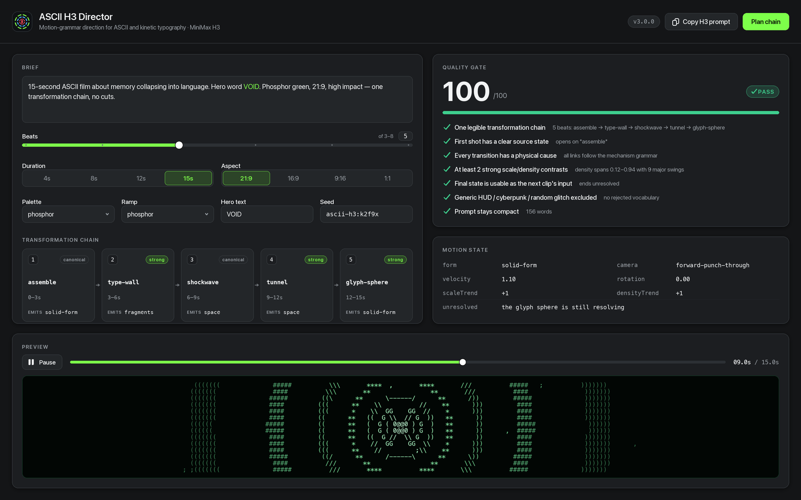
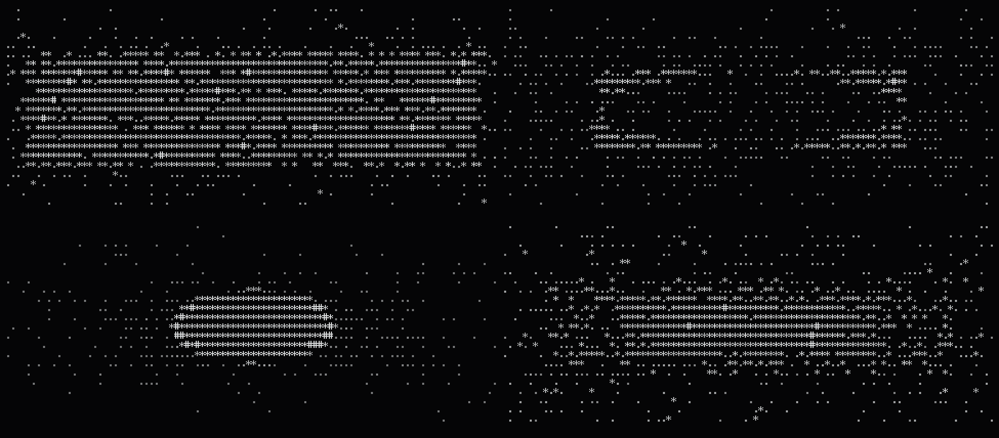
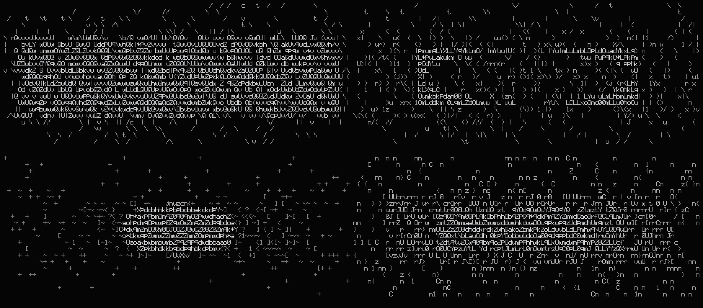
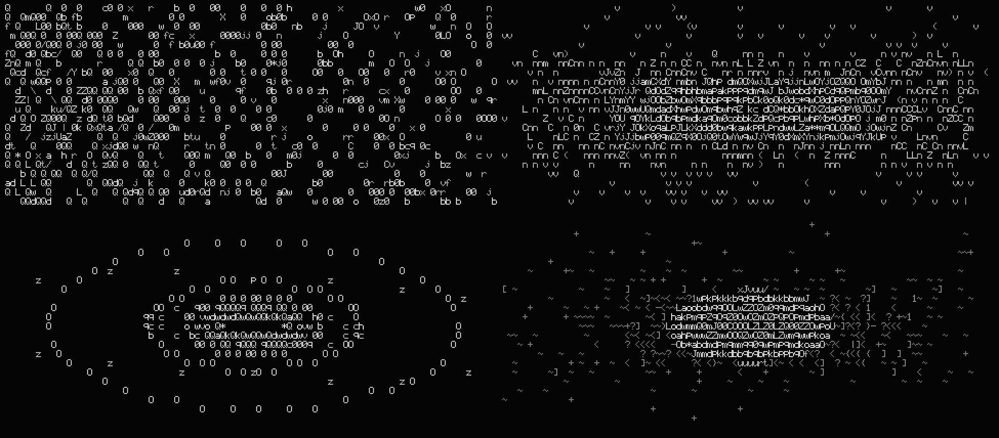

# ASCII H3 Director

[](LICENSE)
[](https://nodejs.org)
[](#requirements)
[](https://github.com/deepseek-ai/deepseek-harness)
[](#install)
[](https://github.com/MiniMax-AI/MiniMax-H3)

[中文](README.zh-CN.md) · [English](README.md) · [한국어](README.ko.md) · [日本語](README.ja.md) · **Français**

---

> Forcer une idée à devenir une chaîne de caractères qui ne cesse de changer de forme.

## Ce que c'est

ASCII H3 Director est un outil de réalisation pour MiniMax H3. Il compile un brief libre en une **chaîne de transformation**, un prompt écrit pour le temps plutôt que pour la prose, et un contrôle qualité qui se dresse entre vous et le bouton de paiement. Il embarque aussi un moteur de rendu ASCII déterministe : une police bitmap 5×9 dessinée à la main qui transforme le même FilmSpec en images de terminal, SVG, PNG et planches contact reproductibles octet pour octet. C'est à la fois un **plugin DeepSeek Harness (DSH)** et un **Agent Skill** portable.

## Nouveautés de la v3 (par rapport à la v1)

La v1 était un skill Markdown accompagné de scripts bash. `generate_h3.sh` transmettait à `mmx video generate`, `continue_from_last_frame.sh` utilisait ffmpeg pour extraire la dernière image du clip précédent, `make_contact_sheet.sh` assemblait les images via un filtre ffmpeg, et chaque règle de réalisation vivait sous forme de prose dans `SKILL.md`. Cela fonctionnait — mais le jugement reposait sur l'honneur du modèle, et il fallait payer avant de voir la moindre image.

| Capacité | v1 | v3 |
| --- | --- | --- |
| Forme | Markdown + wrappers bash | 8 modules ES sans dépendance + plugin DSH + Agent Skill |
| Voir l'image | Générer d'abord, puis extraire avec ffmpeg | Moteur de prévisualisation déterministe — sans clé API |
| Typographie | Aucune (police terminal) | Bitmap 5×9 dessinée à la main, couvrant les 95 glyphes ASCII imprimables |
| Reproductibilité | Non spécifiée | Graine fixe ; deux rendus d'un même FilmSpec ont donné le même SHA-256 (mesuré) |
| Logique de mouvement | Règles en prose | Bibliothèque de 21 mécanismes + table de légalité `FORM_SUCCESSORS` |
| Continuité | « préserver le mouvement précédent » | Contrat de continuité : `exit_state` → `entry_state` + `checkSeam` |
| Qualité | 6 questions auto-évaluées | 7 vérifications automatisées notées /100 ; pas de PASS, pas de génération |
| Analyse de référence | « extraire la grammaire du mouvement » (manuel) | Sous-commande `reference` : STYLE DNA et chaîne déduits des observations |
| Planche contact | ffmpeg requis | Encodeur PNG intégré + planches SVG, **sans ffmpeg** |
| Diffusion | Tout ce qui lit SKILL.md | Plugin DSH Cordis avec outils hôte et panneau Director Console |
| Docs | Anglais | Chinois / Japonais / Anglais |

## Installation

**Voie A — plugin DSH**

```bash
# depuis npm
dsh plugin --profile web add @yankafei/ascii-h3-director

# ou depuis un chemin local (développement)
dsh plugin --profile web add /Users/coffee/Desktop/创造一切可能/ascii-h3-director
```

Une fois installé, le plugin enregistre ses outils hôte auprès de la session et monte le panneau **Director Console** dans l'interface Web.

**Voie B — Agent Skill générique**

```bash
# copie manuelle
mkdir -p ~/.agents/skills
cp -R skill ~/.agents/skills/ascii-h3-director

# ou lancer l'installateur
skill/INSTALL.command
```

L'installateur copie `skill/` vers `~/.agents/skills/ascii-h3-director/` et affiche la commande d'auto-vérification. Les deux voies ne se concurrencent pas : le plugin sert DSH, le skill sert tout agent de codage qui lit `SKILL.md`.

## Démarrage rapide

Tout ce qui suit est une transcription réelle, copiable-collable. Aucune clé API, aucun coût.

```console
$ ascii-h3 doctor
ascii-h3-director v3.0.0

[ok] node                         v24.19.0
[ok] engine modules               8 ramps, 5 palettes
[ok] glyph atlas                  5×9 bitmap font, printable ASCII
[ok] mechanisms                   21 mechanisms in the grammar
[ok] png encoder                  built-in, no image library required
[ok] render smoke test            N cells in Mms
[ok] quality gate                 score 100/100
[ok] mmx-cli (paid generation)    not installed — optional; install with: npm i -g mmx-cli

all core checks passed

$ ascii-h3 plan "15s ASCII clip about memory collapsing into language"
TITLE      15s / ascii / memory / collapsing
SEED       ascii-h3:1wok55r
DURATION   15s @ 21:9
LOOK       brutalist-digital / brutalist / high-impact
HERO TEXT  —

TRANSFORMATION CHAIN
   1. 0–3s       Density Dissolve  [canonical]
      the form dematerialises because its glyph ramp slides toward emptiness while its silhouette holds
      exit → form=field camera=forward-punch-through v=1
   2. 3–6s       Glyph Sphere  [strong]
      thousands of characters orbit a tiny focal mark, then all orbits converge
      exit → form=solid-form camera=forward-punch-through v=1
   3. 6–9s       Typographic Wall  [strong]
      the camera punches through each wall without cutting; the wall shatters from the point of impact outward
      exit → form=fragments camera=forward-punch-through v=1
   4. 9–12s      Command Shockwave  [canonical]
      the release from compression travels outward as a single readable command, dragging microtype in its wake
      exit → form=space camera=forward-punch-through v=1
   5. 12–15s     ASCII Tunnel  [strong]
      the camera travels forward through the rings while they stretch into long perspective trails
      exit → form=space camera=forward-punch-through v=1

QUALITY GATE  PASS  (100/100)
────────────────────────────────────────────────────────────────
  ✔ One legible transformation chain
      5 beat(s): density-dissolve → glyph-sphere → type-wall → shockwave → tunnel
  ✔ First shot has a clear source state
      opens on "density-dissolve"
  ✔ Every transition has a physical cause
      all links follow the mechanism grammar
  ✔ At least 2 strong scale/density contrasts
      density spans 0.12–0.94 with 9 major swing(s)
  ✔ Final state is usable as the next clip’s input
      ends unresolved: the camera is still inside the tunnel with speed left over
  ✔ Generic HUD / cyberpunk / random glitch excluded
      no rejected vocabulary in the positive prompt
  ✔ Prompt stays compact (written for time, not prose)
      153 words

PROMPT (153 words)
────────────────────────────────────────────────────────────────
15-second ultra-wide ASCII kinetic typography sequence.

0–3s: The form dematerialises because its glyph ramp slides toward emptiness while its silhouette holds.
3–6s: Thousands of characters orbit a tiny focal mark, then all orbits converge.
6–9s: The camera punches through each wall without cutting; the wall shatters from the point of impact outward.
9–12s: The release from compression travels outward as a single readable command, dragging microtype in its wake.
12–15s: The camera travels forward through the rings while they stretch into long perspective trails. The camera is still inside the tunnel with speed left over.

STYLE: brutalist digital palette; brutalist character set; brutalist computational motion design; extreme perspective and scale contrast; monospaced glyphs as physical matter, not overlay; 21:9 frame.
RULE: no normal cuts; every transformation physically emerges from the previous form; preserve direction, velocity and scale across every transition; avoid generic HUD, cyberpunk city, random glitch, unmotivated particles, smoke wipes, photoreal humans.

$ ascii-h3 preview "a brutalist ASCII tunnel collapsing into a giant word OPEN" --cols 100 --rows 24
                                  t C                             C
   C                                                                                     C     C
  C        t t     C                 t                             CC                            C
  C C                                 C         C                t
 t      C               t            C                                  GC      t    t
         C          C00CC  C    8 C G   0CCC G   CCCC  C    C    CCG t   C  C     C 0CC0CtC    0  C
  0  C      C  Ct G   CC  C  01G08   C Ct 00000 C C0 0C  C CCCG C0C  C  CC  C   0 G C   0     C 1G
  ... (24 rows of deterministic glyphs)

$ ascii-h3 strip "brutalist ASCII tunnel into giant word OPEN" --frames 6 --out sheet.png
wrote sheet.png (6 frames, 3×2, 1840×592)
```

Omettre `--cols/--rows` pour composer d'abord dans le terminal, puis les augmenter pour l'image finale ; pointer `--out` vers un `.svg` pour obtenir une planche vectorielle.

**La seule étape payante** (et elle est conditionnée au contrôle qualité) :

```bash
# 1. écrire le prompt
ascii-h3 prompt "15s ASCII clip about memory collapsing into language" --out prompt.txt

# 2. générer (H3 est un service payant ; c'est le seul appel facturable du dépôt)
mmx video generate --model MiniMax-H3 --prompt "$(cat prompt.txt)" \
  --duration 15 --ratio 21:9 --download outputs/clip01.mp4
```

Sans `mmx`, `doctor` le signale comme optionnel au lieu d'échouer — le moteur n'en dépend jamais.

## Référence des commandes

| Commande | Arguments | Ce qu'elle fait |
| --- | --- | --- |
| `plan` | `"<brief>" [--seed S] [--beats N] [--json]` | Plan de réalisation complet : chaîne, état de mouvement par beat, contrôle qualité |
| `chain` | `"<brief>" [--beats N] [--json]` | Uniquement la chaîne de transformation |
| `prompt` | `"<brief>" [--out FILE]` | Uniquement le prompt H3 compact |
| `review` | `["<brief>"] [--out prompt.txt] [--json]` | Lance le contrôle qualité seul ; `--out` audite un prompt existant |
| `reference` | `<obs.json> [--json]` | Extrait le STYLE DNA et une chaîne reproductible depuis des observations de référence |
| `continue` | `<exit-state.json> "<brief>" [--json]` | Planifie une suite sans couture héritant de l'état de sortie précédent, en signalant les violations de couture |
| `preview` | `"<brief>" [--t SEC] [--cols N] [--rows N]` | Affiche une image ASCII dans le terminal |
| `svg` | `"<brief>" --t SEC --out FILE.svg` | Exporte une image vectorielle |
| `png` | `"<brief>" --t SEC --out FILE.png` | Exporte une image raster via l'encodeur intégré |
| `strip` | `"<brief>" [--frames N] [--cols N] [--rows N] --out FILE.png\|.svg` | Planche contact de N images régulièrement espacées ; sans ffmpeg |
| `mechanisms` | `[--json]` | Affiche la grammaire du mouvement, groupée par niveau |
| `doctor` | — | Auto-vérification plus un vrai test de rendu |
| `help` / `version` | — | Aide / version |

Options communes : `--seed --beats --duration --ratio --palette --ramp --mode --text "WORD,WORD" --avoid "a,b" --allow --block`, plus `--t --cols --rows --cellW --cellH` pour le rendu.

Choix : `--ramp` ∈ `classic brutalist minimal operators binary data phosphor typographic` ; `--palette` ∈ `brutalist-digital minimal-signal phosphor paper-terminal monolith` ; `--mode` ∈ `high-impact minimal-data` ; `--ratio` ∈ `21:9 16:9 9:16 4:3 1:1 adaptive`.

## La grammaire du mouvement

Un clip n'est pas un style ; c'est une **chaîne de transformation**. Les caractères changent de fonction au fil du temps : le texte devient motif, le motif devient particules, les particules deviennent géométrie, la géométrie devient espace, l'espace redevient typographie. La bibliothèque compte 21 mécanismes répartis en quatre niveaux.

| Niveau | id | Nom | Émet |
| --- | --- | --- | --- |
| canonique | `assemble` | Assemblage depuis un champ clairsemé | `solid-form` |
| canonique | `density-dissolve` | Dissolution par densité | `field` |
| canonique | `structural-decay` | Décroissance structurelle | `fragments` |
| canonique | `letter-fragmentation` | Fragmentation diégétique de la topologie des lettres | `fragments` |
| canonique | `implosion` | Implosion | `void` |
| canonique | `shockwave` | Onde de choc de commande | `space` |
| canonique | `cursor-vortex` | Vortex de curseur | `void` |
| fort | `boot-signal` | Signal de démarrage | `letterform` |
| fort | `contour-migration` | Migration de contour | `solid-form` |
| fort | `tunnel` | Tunnel ASCII | `space` |
| fort | `type-wall` | Mur typographique | `fragments` |
| fort | `glyph-sphere` | Sphère de glyphes | `solid-form` |
| fort | `giant-word` | Typographie géante recadrée | `letterform` |
| fort | `spatial-fold` | Pli spatial | `space` |
| support | `field` | Champ de caractères | `field` |
| support | `mask` | Masque de texte | `letterform` |
| rejet | `reject-hud` | HUD décoratif | `cliche` |
| rejet | `reject-city` | Ville cyberpunk générique | `cliche` |
| rejet | `reject-glitch` | Glitch sans signification | `cliche` |
| rejet | `reject-particles` | Particules sans motivation | `cliche` |
| rejet | `reject-smoke` | Balayage fumée / liquide | `cliche` |

Le niveau `reject` reste dans la grammaire à dessein : le relecteur doit pouvoir **nommer** un échec, pas seulement le qualifier de faible. Les successeurs légaux viennent de `FORM_SUCCESSORS` — par exemple `solid-form → density-dissolve | contour-migration | implosion | type-wall`, et `space → type-wall | tunnel | spatial-fold | glyph-sphere | structural-decay`.

## Le contrat de continuité

Une suite n'est pas une nouvelle scène. L'`exit_state` du prédécesseur **devient** l'`entry_state` du successeur : vecteur caméra, vitesse apparente, rotation, tendance d'échelle, tendance de densité, palette et jeu de caractères sont hérités, et seule l'action non résolue est transmise au lieu d'être redéclarée.

Une couture fautive (réinitialisation caméra, changement de palette, vitesse tombée à zéro — `checkSeam` signale chacune) :

```diff
  // exit_state.json (sortie du clip précédent)
  { "form": "solid-form", "camera": "forward-punch-through",
-   "velocity": 1.1, "palette": "brutalist-digital", "ramp": "brutalist",
-   "unresolved": "the glyph sphere is still resolving when the clip ends" }
  // entry_state (ouverture de la suite) — faux
+ { "form": "void", "camera": "orbital-lock",
+   "velocity": 0, "palette": "phosphor", "ramp": "minimal",
+   "unresolved": "the glyph sphere is still resolving when the clip ends" }
```

Corrigé (ce que produit `inherit()` ; `checkSeam` renvoie un tableau vide) :

```json
{
  "form": "solid-form",
  "camera": "forward-punch-through",
  "velocity": 1.21,
  "rotation": 0,
  "scaleTrend": -1,
  "densityTrend": 1,
  "unresolved": "",
  "palette": "brutalist-digital",
  "ramp": "brutalist"
}
```

`checkSeam` teste : un vecteur caméra qui se réinitialise, une vitesse apparente tombée à zéro, une vitesse qui s'inverse à travers la couture, un changement de palette, un changement de jeu de caractères dominant, et une action non résolue répétée au lieu d'être close. `ascii-h3 continue` affiche chaque violation sous `SEAM: BROKEN` ; `SEAM: holds` signifie que la couture tient.

## Contrôle qualité

Avant de payer, les 7 vérifications doivent toutes répondre oui. Le score est le nombre de vérifications réussies / 7 × 100, et seul un sans-faute renvoie `PASS`.

| id | Vérification | Ce que signifie un échec |
| --- | --- | --- |
| `single-chain` | Une chaîne de transformation lisible (≥3 beats) | Le concept est diffus ; le réduire à une seule chaîne |
| `source-state` | La première image a un état source clair | Pas d'origine, donc le public n'a rien où entrer |
| `physical-cause` | Chaque transition a une cause physique | Un lien n'a pas de successeur légal dans la grammaire |
| `contrast` | Au moins 2 forts contrastes d'échelle/densité | L'image est plate ; élargir l'amplitude compression → relâchement |
| `exit-state` | L'état final est utilisable comme entrée du clip suivant | Le clip se résout complètement et ne peut pas continuer |
| `no-cliche` | Pas de HUD générique / cyberpunk / glitch aléatoire | Du vocabulaire rejeté a fui dans le prompt positif |
| `compact` | Le prompt reste compact (≤320 mots) | Il est écrit comme de la prose au lieu d'être écrit pour le temps |

## L'interface

Le Director Console place tout cela dans l'interface Web de DSH : le brief et les options à gauche, la chaîne de transformation avec l'état de mouvement par beat au milieu, le score du contrôle qualité et une prévisualisation en direct à droite.



Planches contact et images de prévisualisation issues du moteur déterministe :







## Structure du dépôt

```
ascii-h3-director/
├── src/
│   ├── cli.js             # command surface: 13 subcommands, arg parsing, doctor
│   ├── core.js            # seeded RNG, easing, value noise, 8 ramps, 5 palettes
│   ├── glyph-atlas.js     # hand-authored 5×9 bitmap font (ASCII 32–126, 95 glyphs)
│   ├── renderer.js        # Grid / Camera / primitives / planFilm / renderFilmFrame
│   ├── motion-grammar.js  # 21 mechanisms, FORM_SUCCESSORS, inherit / checkSeam
│   ├── director.js        # brief parsing, prompt composition, gate, reference, sequel
│   ├── raster.js          # Grid → text / SVG / RGB
│   └── png.js             # built-in PNG encoder (zlib only, no image library)
├── skill/                 # portable Agent Skill (SKILL.md + references + scripts)
├── docs/                  # trilingual documentation
├── assets/                # README images and contact sheets
└── test/                  # determinism regression tests
```

## Prérequis

- **Node 18+** (`doctor` vérifie explicitement la version majeure)
- Le moteur n'a **aucune dépendance d'exécution** : il tourne sans `node_modules`, et les PNG sont écrits par l'encodeur intégré
- **ffmpeg est optionnel** : `strip`, `preview`, `svg` et `png` n'en ont jamais besoin
- **`mmx-cli` est optionnel** : `npm i -g mmx-cli`, utilisé uniquement pour la génération payante

## Crédits et travaux antérieurs

- [MiniMax-AI/MiniMax-H3](https://github.com/MiniMax-AI/MiniMax-H3) — le modèle H3 et le skill officiel d'écriture de prompts
- [MiniMax-AI/cli](https://github.com/MiniMax-AI/cli) — la CLI `mmx` pour la génération payante et les téléchargements
- [mexicat/pdoom-video](https://github.com/mexicat/pdoom-video) — bible de style, pensée en timeline, relecture par planche contact
- [mrdoob/three.js](https://github.com/mrdoob/three.js) — `AsciiEffect`, la première référence pour le rendu ASCII
- [remotion-dev/remotion](https://github.com/remotion-dev/remotion) — timing piloté par les constantes et flux de rendu programmable
- [motion-canvas/motion-canvas](https://github.com/motion-canvas/motion-canvas) — repli vectoriel/texte rendu par code, optionnel
- [deepseek-ai/deepseek-harness](https://github.com/deepseek-ai/deepseek-harness) — l'hôte du plugin, des outils et du panneau

## Licence

MIT. Contributions : gardez toutes les langues synchronisées et laissez `ascii-h3 doctor` au vert.

<p align="center" data-ecosystem-nav="1"><sub><a href="https://github.com/YanKaFei/Costume-Director-Vault-Starter">Costume</a> · <a href="https://github.com/YanKaFei/art-aesthetic-vault">Art</a> · <a href="https://github.com/YanKaFei/ascii-cinema-engine">ASCII Cinema</a> · <a href="https://github.com/YanKaFei/ascii-h3-director">ASCII H3</a> · <a href="https://github.com/YanKaFei/2d-limited-mv-studio">2D MV</a> · <a href="https://github.com/YanKaFei/virtual-heroine-atlas">Virtual Heroine</a></sub></p>


## DSH ecosystem

- [Costume](https://github.com/YanKaFei/Costume-Director-Vault-Starter) — connaissances visuelles du costume
- [Art](https://github.com/YanKaFei/art-aesthetic-vault) — couches de style art et cinéma
- [ASCII Cinema](https://github.com/YanKaFei/ascii-cinema-engine) — cinéma en grille de caractères
- [ASCII H3](https://github.com/YanKaFei/ascii-h3-director) — direction ASCII / typographie cinétique
- [2D MV](https://github.com/YanKaFei/2d-limited-mv-studio) — package de prompts MV anime 2D
- [Virtual Heroine](https://github.com/YanKaFei/virtual-heroine-atlas) — recherche sur les personnages virtuels
