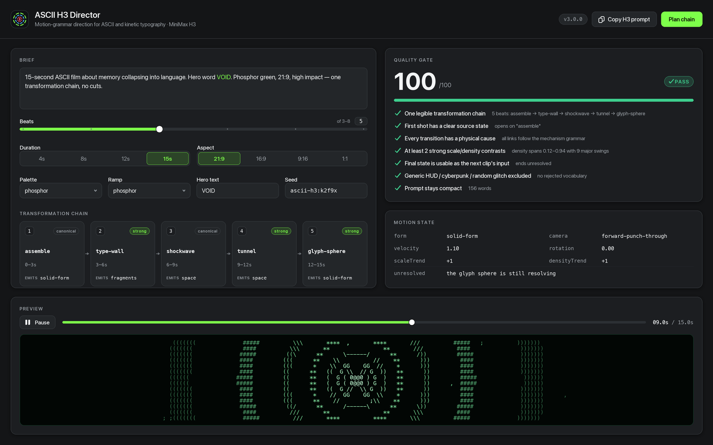
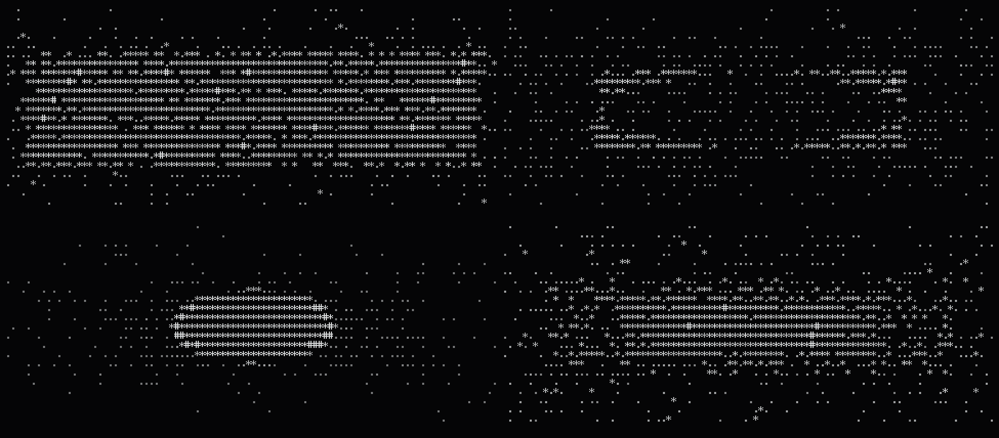
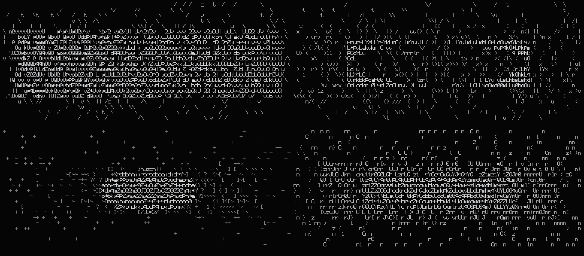
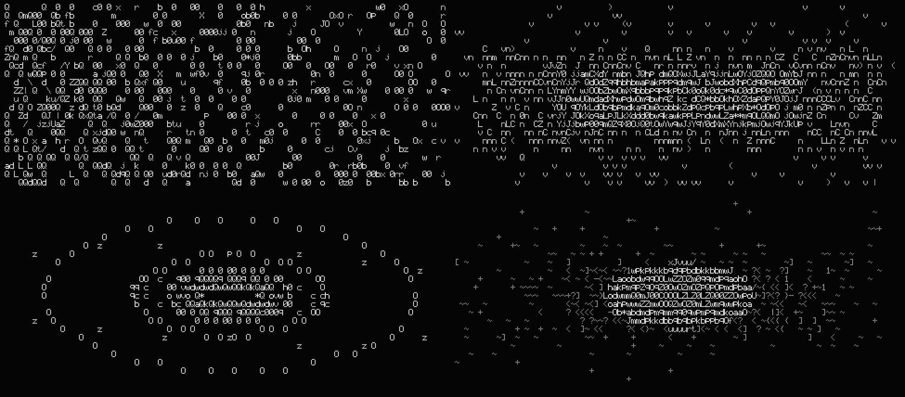

# ASCII H3 Director

[](LICENSE)
[](https://nodejs.org)
[](#requirements)
[](https://github.com/deepseek-ai/deepseek-harness)
[](#install)
[](https://github.com/MiniMax-AI/MiniMax-H3)

[中文](README.zh-CN.md) · [English](README.md) · [한국어](README.ko.md) · **日本語** · [Français](README.fr.md)

---

> ひとつの想念を、変形しつづける文字の連鎖に絞り上げる。

## これは何か

ASCII H3 Director は MiniMax H3 のための演出ツールです。自由な一行のブリーフを**変形チェーン**、時間のために書かれた簡潔なプロンプト、そして支払いの前に立ちはだかる品質ゲートへとコンパイルします。さらに決定論的な ASCII レンダリングエンジンを内蔵し、5×9 の手書きビットマップ書体だけで、同じ FilmSpec をバイト単位で再現可能な端末フレーム・SVG・PNG・コンタクトシートに描き出します。**DeepSeek Harness（DSH）プラグイン**であり、同時に可搬な **Agent Skill** でもあります。

## v3 で新しくなったこと（v1 との比較）

v1 は Markdown のスキルと bash スクリプトの集まりでした。`generate_h3.sh` は `mmx video generate` に丸投げし、`continue_from_last_frame.sh` は ffmpeg で前作の最終フレームを抜き、`make_contact_sheet.sh` は ffmpeg の `tile` フィルタでシートを組み、演出の判断はすべて `SKILL.md` の散文ルールに書かれていました。動きますが、判断はモデルの良識任せ、絵を見るにはまず支払う必要がありました。

| 能力 | v1 | v3 |
| --- | --- | --- |
| 形態 | Markdown + bash ラッパ | 依存ゼロの ES モジュール 8 本 + DSH プラグイン + Agent Skill |
| 絵を見る | 生成してから ffmpeg で抜き出す | 決定論的プレビュー。API キーなしで確認できる |
| 書体 | なし（端末フォント依存） | 手書き 5×9 ビットマップ。印字可能 ASCII 95 字形を収録 |
| 再現性 | 保証なし | シード駆動。同一 FilmSpec の 2 回レンダリングが SHA-256 一致（実測済み） |
| 運動の論理 | 散文のルール | 21 機構の文法ライブラリ + `FORM_SUCCESSORS` 後継表 |
| 接続 | 「前フレームの運動を保つ」 | 連続性契約：`exit_state` → `entry_state` 継承 + `checkSeam` 検証 |
| 品質 | 6 つの自問 | 7 項目を自動採点（/100）。合格しないと生成しない |
| 参照分析 | 「運動文法を抽出」（手作業） | `reference` サブコマンド：観測 JSON から STYLE DNA とチェーンを逆算 |
| コンタクトシート | ffmpeg 必須 | 内蔵 PNG エンコーダ + SVG シート。**ffmpeg 不要** |
| 配布 | SKILL.md が読めれば可 | DSH Cordis プラグイン（ホストツール + Director Console パネル） |
| ドキュメント | 英語 | 中 / 日 / 英 の三言語 |

## インストール

**経路 A — DSH プラグイン**

```bash
# npm から
dsh plugin --profile web add @yankafei/ascii-h3-director

# ローカルパスから（開発時）
dsh plugin --profile web add /Users/coffee/Desktop/创造一切可能/ascii-h3-director
```

導入後、プラグインはセッションにホストツールを登録し、Web UI に **Director Console** パネルを載せます。

**経路 B — 汎用 Agent Skill**

```bash
# 手動コピー
mkdir -p ~/.agents/skills
cp -R skill ~/.agents/skills/ascii-h3-director

# またはインストーラ
skill/INSTALL.command
```

`skill/` が `~/.agents/skills/ascii-h3-director/` にコピーされ、自己検証コマンドが表示されます。2 つの経路は競合しません。プラグインは DSH に、Skill は `SKILL.md` を読むあらゆるコーディングエージェントに。

## クイックスタート

以下はすべて実際に実行できるターミナル記録です。この段階で API キーは不要、費用もゼロです。

```console
$ ascii-h3 doctor
ascii-h3-director v3.0.0

[ok] node                         v24.19.0
[ok] engine modules               8 ramps, 5 palettes
[ok] glyph atlas                  5×9 bitmap font, printable ASCII
[ok] mechanisms                   21 mechanisms in the grammar
[ok] png encoder                  built-in, no image library required
[ok] render smoke test            N cells in Mms
[ok] quality gate                 score 100/100
[ok] mmx-cli (paid generation)    not installed — optional; install with: npm i -g mmx-cli

all core checks passed

$ ascii-h3 plan "15s ASCII clip about memory collapsing into language"
TITLE      15s / ascii / memory / collapsing
SEED       ascii-h3:1wok55r
DURATION   15s @ 21:9
LOOK       brutalist-digital / brutalist / high-impact
HERO TEXT  —

TRANSFORMATION CHAIN
   1. 0–3s       Density Dissolve  [canonical]
      the form dematerialises because its glyph ramp slides toward emptiness while its silhouette holds
      exit → form=field camera=forward-punch-through v=1
   2. 3–6s       Glyph Sphere  [strong]
      thousands of characters orbit a tiny focal mark, then all orbits converge
      exit → form=solid-form camera=forward-punch-through v=1
   3. 6–9s       Typographic Wall  [strong]
      the camera punches through each wall without cutting; the wall shatters from the point of impact outward
      exit → form=fragments camera=forward-punch-through v=1
   4. 9–12s      Command Shockwave  [canonical]
      the release from compression travels outward as a single readable command, dragging microtype in its wake
      exit → form=space camera=forward-punch-through v=1
   5. 12–15s     ASCII Tunnel  [strong]
      the camera travels forward through the rings while they stretch into long perspective trails
      exit → form=space camera=forward-punch-through v=1

QUALITY GATE  PASS  (100/100)
────────────────────────────────────────────────────────────────
  ✔ One legible transformation chain
      5 beat(s): density-dissolve → glyph-sphere → type-wall → shockwave → tunnel
  ✔ First shot has a clear source state
      opens on "density-dissolve"
  ✔ Every transition has a physical cause
      all links follow the mechanism grammar
  ✔ At least 2 strong scale/density contrasts
      density spans 0.12–0.94 with 9 major swing(s)
  ✔ Final state is usable as the next clip’s input
      ends unresolved: the camera is still inside the tunnel with speed left over
  ✔ Generic HUD / cyberpunk / random glitch excluded
      no rejected vocabulary in the positive prompt
  ✔ Prompt stays compact (written for time, not prose)
      153 words

PROMPT (153 words)
────────────────────────────────────────────────────────────────
15-second ultra-wide ASCII kinetic typography sequence.

0–3s: The form dematerialises because its glyph ramp slides toward emptiness while its silhouette holds.
3–6s: Thousands of characters orbit a tiny focal mark, then all orbits converge.
6–9s: The camera punches through each wall without cutting; the wall shatters from the point of impact outward.
9–12s: The release from compression travels outward as a single readable command, dragging microtype in its wake.
12–15s: The camera travels forward through the rings while they stretch into long perspective trails. The camera is still inside the tunnel with speed left over.

STYLE: brutalist digital palette; brutalist character set; brutalist computational motion design; extreme perspective and scale contrast; monospaced glyphs as physical matter, not overlay; 21:9 frame.
RULE: no normal cuts; every transformation physically emerges from the previous form; preserve direction, velocity and scale across every transition; avoid generic HUD, cyberpunk city, random glitch, unmotivated particles, smoke wipes, photoreal humans.

$ ascii-h3 preview "a brutalist ASCII tunnel collapsing into a giant word OPEN" --cols 100 --rows 24
                                  t C                             C
   C                                                                                     C     C
  C        t t     C                 t                             CC                            C
  C C                                 C         C                t
 t      C               t            C                                  GC      t    t
         C          C00CC  C    8 C G   0CCC G   CCCC  C    C    CCG t   C  C     C 0CC0CtC    0  C
  0  C      C  Ct G   CC  C  01G08   C Ct 00000 C C0 0C  C CCCG C0C  C  CC  C   0 G C   0     C 1G
  ... (24 行の決定論的なグリフ)

$ ascii-h3 strip "brutalist ASCII tunnel into giant word OPEN" --frames 6 --out sheet.png
wrote sheet.png (6 frames, 3×2, 1840×592)
```

`--cols/--rows` を小さくすれば端末で構図を確認でき、`--out` を `.svg` にすればベクターのシートになります。

**唯一お金がかかる段階**（ゲートが PASS していることが前提）:

```bash
# 1. プロンプトを書き出す
ascii-h3 prompt "15s ASCII clip about memory collapsing into language" --out prompt.txt

# 2. 生成（H3 は有償サービス。課金を伴う呼び出しはこの一手順だけ）
mmx video generate --model MiniMax-H3 --prompt "$(cat prompt.txt)" \
  --duration 15 --ratio 21:9 --download outputs/clip01.mp4
```

`mmx` が無くても `doctor` は「任意」と報告するだけで失敗にはしません。エンジンはそれに依存しません。

## コマンドリファレンス

| コマンド | 引数 | 動作 |
| --- | --- | --- |
| `plan` | `"<brief>" [--seed S] [--beats N] [--json]` | 演出の全体像：変形チェーン、各拍の運動状態、品質ゲート |
| `chain` | `"<brief>" [--beats N] [--json]` | 変形チェーンのみ |
| `prompt` | `"<brief>" [--out FILE]` | 簡潔な H3 プロンプトのみ |
| `review` | `["<brief>"] [--out prompt.txt] [--json]` | 品質ゲートのみ実行。`--out` で既存プロンプトを審査 |
| `reference` | `<obs.json> [--json]` | 参照映像の観測 JSON から STYLE DNA と運動チェーンを抽出 |
| `continue` | `<exit-state.json> "<brief>" [--json]` | 継ぎ目のない続編を設計。前作の出口状態を継承し、違反を報告 |
| `preview` | `"<brief>" [--t SEC] [--cols N] [--rows N]` | 1 フレームを端末に印字 |
| `svg` | `"<brief>" --t SEC --out FILE.svg` | ベクター 1 フレームを書き出し |
| `png` | `"<brief>" --t SEC --out FILE.png` | ラスター 1 フレームを書き出し（内蔵エンコーダ） |
| `strip` | `"<brief>" [--frames N] [--cols N] [--rows N] --out FILE.png\|.svg` | 等間隔 N フレームのコンタクトシート。ffmpeg 不要 |
| `mechanisms` | `[--json]` | 運動文法を階層ごとに表示 |
| `doctor` | — | 自己診断とレンダリングのスモークテスト |
| `help` / `version` | — | 使い方 / バージョン |

共通フラグ：`--seed --beats --duration --ratio --palette --ramp --mode --text "WORD,WORD" --avoid "a,b" --allow --block`、描画用に `--t --cols --rows --cellW --cellH`。

選択肢：`--ramp` ∈ `classic brutalist minimal operators binary data phosphor typographic`、`--palette` ∈ `brutalist-digital minimal-signal phosphor paper-terminal monolith`、`--mode` ∈ `high-impact minimal-data`、`--ratio` ∈ `21:9 16:9 9:16 4:3 1:1 adaptive`。

## 運動文法

作品は「スタイル」ではなく**変形チェーン**です。文字は時間とともに機能を変えます。文字が模様になり、模様が粒子になり、粒子が幾何になり、幾何が空間になり、空間がまた文字へ戻る。文法ライブラリは 21 の機構を 4 階層に分けます。

| 階層 | id | 名称 | 残すもの（emits） |
| --- | --- | --- | --- |
| canonical | `assemble` | Assemble from Sparse Field | `solid-form` |
| canonical | `density-dissolve` | Density Dissolve | `field` |
| canonical | `structural-decay` | Structural Decay | `fragments` |
| canonical | `letter-fragmentation` | Diegetic Letter-Topology Fragmentation | `fragments` |
| canonical | `implosion` | Implosion | `void` |
| canonical | `shockwave` | Command Shockwave | `space` |
| canonical | `cursor-vortex` | Cursor Vortex | `void` |
| strong | `boot-signal` | Boot Signal | `letterform` |
| strong | `contour-migration` | Contour Migration | `solid-form` |
| strong | `tunnel` | ASCII Tunnel | `space` |
| strong | `type-wall` | Typographic Wall | `fragments` |
| strong | `glyph-sphere` | Glyph Sphere | `solid-form` |
| strong | `giant-word` | Giant Cropped Typography | `letterform` |
| strong | `spatial-fold` | Spatial Fold | `space` |
| support | `field` | Character Field | `field` |
| support | `mask` | Text Mask | `letterform` |
| reject | `reject-hud` | Decorative HUD | `cliche` |
| reject | `reject-city` | Generic Cyberpunk City | `cliche` |
| reject | `reject-glitch` | Meaningless Glitch | `cliche` |
| reject | `reject-particles` | Unmotivated Particles | `cliche` |
| reject | `reject-smoke` | Smoke / Liquid Wipe | `cliche` |

`reject` 階層はあえて文法に残しています。レビュアーが失敗に**名前を与えられる**必要があるからです。合法な後続は `FORM_SUCCESSORS` が決めます（例：`solid-form → density-dissolve | contour-migration | implosion | type-wall`、`space → type-wall | tunnel | spatial-fold | glyph-sphere | structural-decay`）。

## 連続性契約

続編は新しい場面ではありません。前作の `exit_state` が次作の `entry_state` に**なる**のです。カメラベクトル、見かけの速度、回転、スケール傾向、密度傾向、パレット、文字集合がすべて継承され、未解決の動作だけが再宣言ではなく引き継がれます。

違反例（カメラのリセット + パレット変更 + 速度ゼロ。`checkSeam` が項目ごとに報告します）:

```diff
  // exit_state.json（前作の出口）
  { "form": "solid-form", "camera": "forward-punch-through",
-   "velocity": 1.1, "palette": "brutalist-digital", "ramp": "brutalist",
-   "unresolved": "the glyph sphere is still resolving when the clip ends" }
  // entry_state（続編の入口）—— 誤り
+ { "form": "void", "camera": "orbital-lock",
+   "velocity": 0, "palette": "phosphor", "ramp": "minimal",
+   "unresolved": "the glyph sphere is still resolving when the clip ends" }
```

修正後（`inherit()` の出力。`checkSeam` は空配列を返します）:

```json
{
  "form": "solid-form",
  "camera": "forward-punch-through",
  "velocity": 1.21,
  "rotation": 0,
  "scaleTrend": -1,
  "densityTrend": 1,
  "unresolved": "",
  "palette": "brutalist-digital",
  "ramp": "brutalist"
}
```

`checkSeam` が検査するのは：カメラベクトルのリセット、見かけの速度のゼロ落ち、継ぎ目での速度方向の反転、パレットの変化、主導文字集合の変化、未解決動作の反復。`ascii-h3 continue` は違反を `SEAM: BROKEN` の下に列挙し、`SEAM: holds` なら継ぎ目は成立しています。

## 品質ゲート

支払いの前に 7 項目すべてに「はい」と答えられる必要があります。得点は通過数 / 7 × 100、全通過で `PASS`。

| id | 検査 | 落ちたときの意味 |
| --- | --- | --- |
| `single-chain` | 読める変形チェーンが 1 本ある（3 拍以上） | 概念が散っている。まず 1 本に絞る |
| `source-state` | 最初のショットに明白な初期状態がある | 起点がなく、観客が迷う |
| `physical-cause` | すべての転換に物理的な原因がある | 文法上、合法な後続でない繋ぎがある |
| `contrast` | 強い尺度/密度の対比が 2 回以上 | 画面が平坦。圧縮と解放の振り幅を上げる |
| `exit-state` | 最終状態を次作の入力にできる | 完全に収束しており続けられない |
| `no-cliche` | 肯定プロンプトに HUD / サイバー都市 / ランダムグリッチがない | 陳腐な語彙が肯定側に混入している |
| `compact` | プロンプトが簡潔（320 語以下） | 散文ではなく時間のために書く |

## インターフェース

Director Console はこのすべてを DSH Web UI に載せます。左にブリーフとフラグ、中央に変形チェーンと各拍の状態、右にゲートの得点とプレビュー。



決定論的エンジンが出力するコンタクトシートとプレビュー:







## リポジトリ構成

```
ascii-h3-director/
├── src/
│   ├── cli.js             # コマンド面：13 サブコマンド、引数解析、doctor
│   ├── core.js            # シード RNG、イージング、値ノイズ、8 ランプ、5 パレット
│   ├── glyph-atlas.js     # 手書き 5×9 ビットマップ書体（ASCII 32–126、95 字形）
│   ├── renderer.js        # Grid / Camera / プリミティブ / planFilm / renderFilmFrame
│   ├── motion-grammar.js  # 21 機構、FORM_SUCCESSORS、inherit / checkSeam
│   ├── director.js        # ブリーフ解析、プロンプト合成、品質ゲート、参照分析、続編
│   ├── raster.js          # Grid → テキスト / SVG / RGB
│   └── png.js             # 内蔵 PNG エンコーダ（zlib のみ、外部依存なし）
├── skill/                 # 可搬 Agent Skill（SKILL.md + references + scripts）
├── docs/                  # 三言語ドキュメント
├── assets/                # README 画像とコンタクトシート
└── test/                  # 決定論の回帰テスト
```

## 動作要件

- **Node 18+**（`doctor` がメジャー版を明示的に検査）
- エンジンの**ランタイム依存はゼロ**。`node_modules` なしで動き、PNG は内蔵エンコーダが書きます
- **ffmpeg は任意**：`strip` / `preview` / `svg` / `png` はいずれも不要
- **`mmx-cli` は任意**：`npm i -g mmx-cli`、有償生成のみに使用

## クレジットと先行事例

- [MiniMax-AI/MiniMax-H3](https://github.com/MiniMax-AI/MiniMax-H3) — H3 モデルと公式 prompt-writing スキル
- [MiniMax-AI/cli](https://github.com/MiniMax-AI/cli) — `mmx` CLI（有償生成とダウンロード）
- [mexicat/pdoom-video](https://github.com/mexicat/pdoom-video) — スタイルバイブル、タイムライン思考、シートレビュー
- [mrdoob/three.js](https://github.com/mrdoob/three.js) — `AsciiEffect`。初期 ASCII レンダリングの参照
- [remotion-dev/remotion](https://github.com/remotion-dev/remotion) — 定数優先のタイミングとプログラマブルな描画
- [motion-canvas/motion-canvas](https://github.com/motion-canvas/motion-canvas) — コード駆動のベクター/文字アニメの代替
- [deepseek-ai/deepseek-harness](https://github.com/deepseek-ai/deepseek-harness) — プラグイン、ツール、パネルのホスト

## ライセンス

MIT。貢献の際は三言語 README を同期させ、`ascii-h3 doctor` を通してください。

---

<p align="center" data-ecosystem-nav="1"><sub><a href="https://github.com/YanKaFei/Costume-Director-Vault-Starter">Costume</a> · <a href="https://github.com/YanKaFei/art-aesthetic-vault">Art</a> · <a href="https://github.com/YanKaFei/ascii-cinema-engine">ASCII Cinema</a> · <a href="https://github.com/YanKaFei/ascii-h3-director">ASCII H3</a> · <a href="https://github.com/YanKaFei/2d-limited-mv-studio">2D MV</a> · <a href="https://github.com/YanKaFei/virtual-heroine-atlas">Virtual Heroine</a></sub></p>


## DSH ecosystem

- [Costume](https://github.com/YanKaFei/Costume-Director-Vault-Starter) — 衣装の視覚知識
- [Art](https://github.com/YanKaFei/art-aesthetic-vault) — 美術・映画スタイルのレイヤー
- [ASCII Cinema](https://github.com/YanKaFei/ascii-cinema-engine) — 文字グリッド・シネマ
- [ASCII H3](https://github.com/YanKaFei/ascii-h3-director) — ASCII / キネティック・タイポグラフィ演出
- [2D MV](https://github.com/YanKaFei/2d-limited-mv-studio) — 2D アニメ MV プロンプト
- [Virtual Heroine](https://github.com/YanKaFei/virtual-heroine-atlas) — バーチャルキャラクター研究
