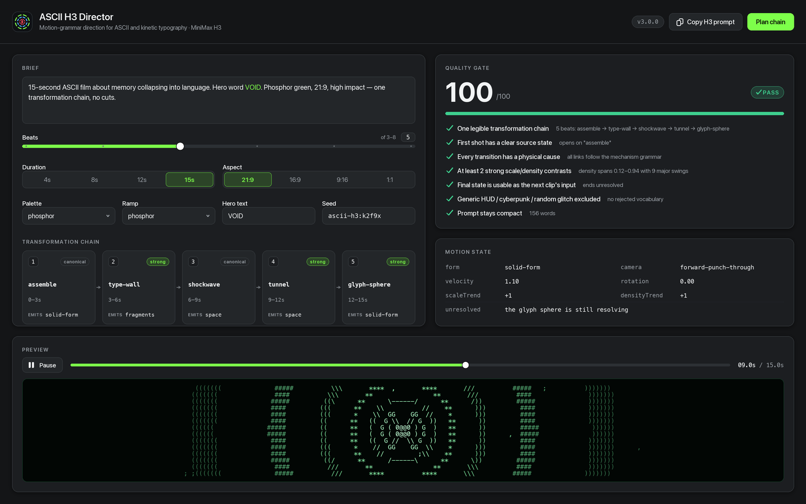
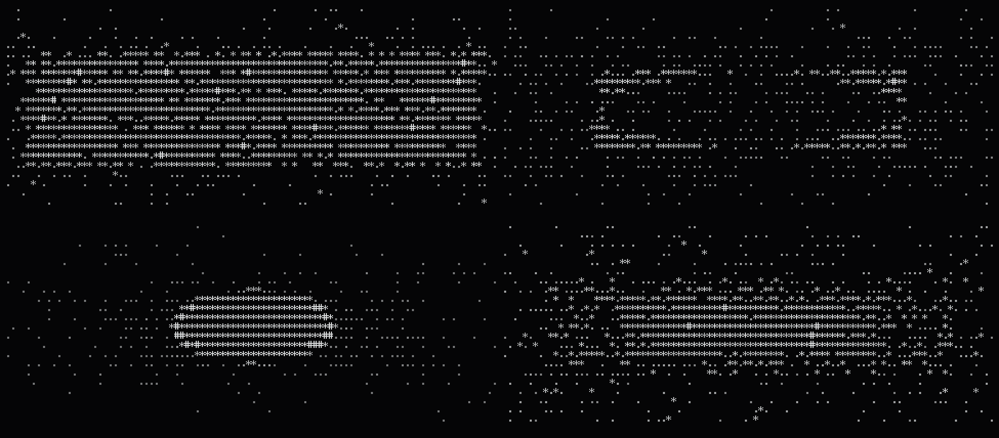
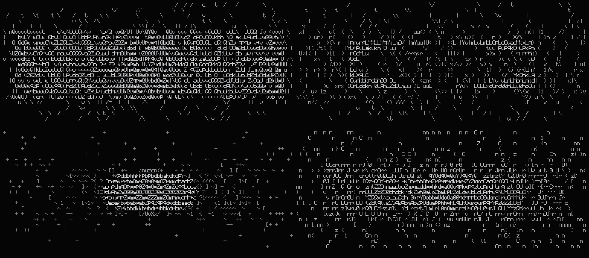
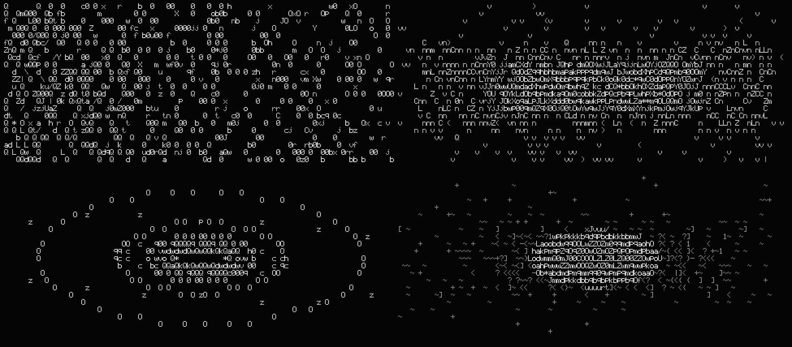

# ASCII H3 Director

[](LICENSE)
[](https://nodejs.org)
[](#requirements)
[](https://github.com/deepseek-ai/deepseek-harness)
[](#install)
[](https://github.com/MiniMax-AI/MiniMax-H3)

[中文](README.zh-CN.md) · [English](README.md) · **한국어** · [日本語](README.ja.md) · [Français](README.fr.md)

---

> 하나의 아이디어를, 끊임없이 형태를 바꾸는 문자 체인으로 밀어붙인다.

## 이것은 무엇인가

ASCII H3 Director는 MiniMax H3를 위한 연출 도구입니다. 자유로운 설명을 **변형 체인**(transformation chain), 산문이 아니라 시간을 위해 쓰인 프롬프트, 그리고 결제 버튼 앞에서 멈춰 세우는 품질 게이트로 컴파일합니다. 또한 결정론적 ASCII 렌더 엔진을 내장합니다. 손으로 새긴 5×9 비트맵 폰트가 동일한 FilmSpec을 바이트 단위로 재현 가능한 터미널 프레임, SVG, PNG, 콘택트 시트로 변환합니다. **DeepSeek Harness(DSH) 플러그인**이자 이식 가능한 **Agent Skill**입니다.

## v3에서 새로워진 것 (v1 대비)

v1은 Markdown 스킬과 bash 스크립트였습니다. `generate_h3.sh`는 `mmx video generate`로 전달했고, `continue_from_last_frame.sh`는 ffmpeg로 이전 클립의 마지막 프레임을 뽑았고, `make_contact_sheet.sh`는 ffmpeg 필터로 프레임을 이어 붙였습니다. 그리고 모든 연출 규칙은 `SKILL.md` 안의 산문으로 살았습니다. 동작은 했지만 — 판단은 모델의 양심에 맡겨졌고, 단 한 프레임이라도 보려면 먼저 비용을 지불해야 했습니다.

| 능력 | v1 | v3 |
| --- | --- | --- |
| 형태 | Markdown + bash 래퍼 | 의존성 없는 ES 모듈 8개 + DSH 플러그인 + Agent Skill |
| 프레임 보기 | 먼저 생성한 뒤 ffmpeg로 추출 | 결정론적 프리뷰 엔진 — API 키 불필요 |
| 서체 | 없음 (터미널 폰트) | 인쇄 가능한 ASCII 95개 글리프를 모두 담은 손수 제작 5×9 비트맵 |
| 재현성 | 명시되지 않음 | 시드 고정, 동일 FilmSpec을 두 번 렌더링해 SHA-256 일치(측정값) |
| 모션 로직 | 산문 규칙 | 21개 메커니즘 문법 라이브러리 + `FORM_SUCCESSORS` 적법성 표 |
| 연속성 | "이전 모션을 유지" | 연속성 계약: `exit_state` → `entry_state` + `checkSeam` |
| 품질 | 자기 질문 6개 | 자동 검사 7개를 /100으로 채점, PASS 없으면 생성 없음 |
| 레퍼런스 분석 | "모션 문법을 추출"(수동) | `reference` 서브커맨드: 관찰에서 STYLE DNA와 체인을 추론 |
| 콘택트 시트 | ffmpeg 필요 | 내장 PNG 인코더 + SVG 시트, **ffmpeg 불필요** |
| 배포 | SKILL.md를 읽는 무엇이든 | 호스트 도구와 Director Console 패널을 갖춘 DSH Cordis 플러그인 |
| 문서 | 영어 | 중국어 / 일본어 / 영어 |

## 설치

**경로 A — DSH 플러그인**

```bash
# npm에서
dsh plugin --profile web add @yankafei/ascii-h3-director

# 또는 로컬 경로에서 (개발 시)
dsh plugin --profile web add /Users/coffee/Desktop/创造一切可能/ascii-h3-director
```

설치되면 플러그인이 세션에 호스트 도구를 등록하고 웹 UI에 **Director Console** 패널을 마운트합니다.

**경로 B — 범용 Agent Skill**

```bash
# 직접 복사
mkdir -p ~/.agents/skills
cp -R skill ~/.agents/skills/ascii-h3-director

# 또는 설치 스크립트 실행
skill/INSTALL.command
```

설치 스크립트는 `skill/`을 `~/.agents/skills/ascii-h3-director/`로 복사하고 자가 점검 명령을 출력합니다. 두 경로는 서로 충돌하지 않습니다. 플러그인은 DSH를 위한 것이고, 스킬은 `SKILL.md`를 읽는 모든 코딩 에이전트를 위한 것입니다.

## 빠른 시작

아래의 모든 내용은 실제로 복사해 붙여넣을 수 있는 기록입니다. API 키도, 비용도 없습니다.

```console
$ ascii-h3 doctor
ascii-h3-director v3.0.0

[ok] node                         v24.19.0
[ok] engine modules               8 ramps, 5 palettes
[ok] glyph atlas                  5×9 bitmap font, printable ASCII
[ok] mechanisms                   21 mechanisms in the grammar
[ok] png encoder                  built-in, no image library required
[ok] render smoke test            N cells in Mms
[ok] quality gate                 score 100/100
[ok] mmx-cli (paid generation)    not installed — optional; install with: npm i -g mmx-cli

all core checks passed

$ ascii-h3 plan "15s ASCII clip about memory collapsing into language"
TITLE      15s / ascii / memory / collapsing
SEED       ascii-h3:1wok55r
DURATION   15s @ 21:9
LOOK       brutalist-digital / brutalist / high-impact
HERO TEXT  —

TRANSFORMATION CHAIN
   1. 0–3s       Density Dissolve  [canonical]
      the form dematerialises because its glyph ramp slides toward emptiness while its silhouette holds
      exit → form=field camera=forward-punch-through v=1
   2. 3–6s       Glyph Sphere  [strong]
      thousands of characters orbit a tiny focal mark, then all orbits converge
      exit → form=solid-form camera=forward-punch-through v=1
   3. 6–9s       Typographic Wall  [strong]
      the camera punches through each wall without cutting; the wall shatters from the point of impact outward
      exit → form=fragments camera=forward-punch-through v=1
   4. 9–12s      Command Shockwave  [canonical]
      the release from compression travels outward as a single readable command, dragging microtype in its wake
      exit → form=space camera=forward-punch-through v=1
   5. 12–15s     ASCII Tunnel  [strong]
      the camera travels forward through the rings while they stretch into long perspective trails
      exit → form=space camera=forward-punch-through v=1

QUALITY GATE  PASS  (100/100)
────────────────────────────────────────────────────────────────
  ✔ One legible transformation chain
      5 beat(s): density-dissolve → glyph-sphere → type-wall → shockwave → tunnel
  ✔ First shot has a clear source state
      opens on "density-dissolve"
  ✔ Every transition has a physical cause
      all links follow the mechanism grammar
  ✔ At least 2 strong scale/density contrasts
      density spans 0.12–0.94 with 9 major swing(s)
  ✔ Final state is usable as the next clip’s input
      ends unresolved: the camera is still inside the tunnel with speed left over
  ✔ Generic HUD / cyberpunk / random glitch excluded
      no rejected vocabulary in the positive prompt
  ✔ Prompt stays compact (written for time, not prose)
      153 words

PROMPT (153 words)
────────────────────────────────────────────────────────────────
15-second ultra-wide ASCII kinetic typography sequence.

0–3s: The form dematerialises because its glyph ramp slides toward emptiness while its silhouette holds.
3–6s: Thousands of characters orbit a tiny focal mark, then all orbits converge.
6–9s: The camera punches through each wall without cutting; the wall shatters from the point of impact outward.
9–12s: The release from compression travels outward as a single readable command, dragging microtype in its wake.
12–15s: The camera travels forward through the rings while they stretch into long perspective trails. The camera is still inside the tunnel with speed left over.

STYLE: brutalist digital palette; brutalist character set; brutalist computational motion design; extreme perspective and scale contrast; monospaced glyphs as physical matter, not overlay; 21:9 frame.
RULE: no normal cuts; every transformation physically emerges from the previous form; preserve direction, velocity and scale across every transition; avoid generic HUD, cyberpunk city, random glitch, unmotivated particles, smoke wipes, photoreal humans.

$ ascii-h3 preview "a brutalist ASCII tunnel collapsing into a giant word OPEN" --cols 100 --rows 24
                                  t C                             C
   C                                                                                     C     C
  C        t t     C                 t                             CC                            C
  C C                                 C         C                t
 t      C               t            C                                  GC      t    t
         C          C00CC  C    8 C G   0CCC G   CCCC  C    C    CCG t   C  C     C 0CC0CtC    0  C
  0  C      C  Ct G   CC  C  01G08   C Ct 00000 C C0 0C  C CCCG C0C  C  CC  C   0 G C   0     C 1G
  ... (24 rows of deterministic glyphs)

$ ascii-h3 strip "brutalist ASCII tunnel into giant word OPEN" --frames 6 --out sheet.png
wrote sheet.png (6 frames, 3×2, 1840×592)
```

`--cols/--rows`를 생략하면 먼저 터미널에서 구도을 잡고, 최종 이미지를 위해 값을 올리면 됩니다. `--out`을 `.svg`로 지정하면 벡터 시트를 얻습니다.

**유일하게 비용이 드는 단계** (그리고 이 단계는 품질 게이트에 걸려 있습니다):

```bash
# 1. 프롬프트 작성
ascii-h3 prompt "15s ASCII clip about memory collapsing into language" --out prompt.txt

# 2. 생성 (H3는 유료 서비스이며, 이 저장소에서 유일하게 과금되는 호출입니다)
mmx video generate --model MiniMax-H3 --prompt "$(cat prompt.txt)" \
  --duration 15 --ratio 21:9 --download outputs/clip01.mp4
```

`mmx`가 없으면 `doctor`는 실패하는 대신 선택 사항으로 보고합니다 — 엔진은 결코 그것에 의존하지 않습니다.

## 명령 레퍼런스

| 명령 | 인자 | 하는 일 |
| --- | --- | --- |
| `plan` | `"<brief>" [--seed S] [--beats N] [--json]` | 전체 연출 계획: 체인, 비트별 모션 상태, 품질 게이트 |
| `chain` | `"<brief>" [--beats N] [--json]` | 변형 체인만 |
| `prompt` | `"<brief>" [--out FILE]` | 압축된 H3 프롬프트만 |
| `review` | `["<brief>"] [--out prompt.txt] [--json]` | 품질 게이트만 실행, `--out`은 기존 프롬프트를 감사 |
| `reference` | `<obs.json> [--json]` | 레퍼런스 관찰에서 STYLE DNA와 재현 가능한 체인을 추출 |
| `continue` | `<exit-state.json> "<brief>" [--json]` | 이전 출구 상태를 이어받는 이음새 없는 후속편을 계획하고 이음새 위반을 보고 |
| `preview` | `"<brief>" [--t SEC] [--cols N] [--rows N]` | 터미널에 ASCII 프레임 하나를 출력 |
| `svg` | `"<brief>" --t SEC --out FILE.svg` | 벡터 프레임 하나를 내보내기 |
| `png` | `"<brief>" --t SEC --out FILE.png` | 내장 인코더로 래스터 프레임 하나를 내보내기 |
| `strip` | `"<brief>" [--frames N] [--cols N] [--rows N] --out FILE.png\|.svg` | 균등 간격 N개 프레임의 콘택트 시트, ffmpeg 불필요 |
| `mechanisms` | `[--json]` | 모션 문법을 계층별로 출력 |
| `doctor` | — | 자가 점검과 실제 렌더 스모크 테스트 |
| `help` / `version` | — | 사용법 / 버전 |

공통 플래그: `--seed --beats --duration --ratio --palette --ramp --mode --text "WORD,WORD" --avoid "a,b" --allow --block`, 렌더링에는 `--t --cols --rows --cellW --cellH`.

선택지: `--ramp` ∈ `classic brutalist minimal operators binary data phosphor typographic`; `--palette` ∈ `brutalist-digital minimal-signal phosphor paper-terminal monolith`; `--mode` ∈ `high-impact minimal-data`; `--ratio` ∈ `21:9 16:9 9:16 4:3 1:1 adaptive`.

## 모션 문법

클립은 스타일이 아니라 **변형 체인**입니다. 문자는 시간에 따라 기능을 바꿉니다. 텍스트는 패턴이 되고, 패턴은 입자가 되고, 입자는 기하학이 되고, 기하학은 공간이 되고, 공간은 다시 타이포그래피가 됩니다. 라이브러리는 네 계층에 걸쳐 21개 메커니즘을 담고 있습니다.

| 계층 | id | 이름 | 방출 |
| --- | --- | --- | --- |
| canonical | `assemble` | 희소 필드에서 조립 | `solid-form` |
| canonical | `density-dissolve` | 밀도 용해 | `field` |
| canonical | `structural-decay` | 구조적 붕괴 | `fragments` |
| canonical | `letter-fragmentation` | 디제틱 문자 위상 분절 | `fragments` |
| canonical | `implosion` | 내파 | `void` |
| canonical | `shockwave` | 커맨드 충격파 | `space` |
| canonical | `cursor-vortex` | 커서 소용돌이 | `void` |
| strong | `boot-signal` | 부트 신호 | `letterform` |
| strong | `contour-migration` | 윤곽 이동 | `solid-form` |
| strong | `tunnel` | ASCII 터널 | `space` |
| strong | `type-wall` | 타이포그래픽 벽 | `fragments` |
| strong | `glyph-sphere` | 글리프 구체 | `solid-form` |
| strong | `giant-word` | 잘린 거대 타이포그래피 | `letterform` |
| strong | `spatial-fold` | 공간 접기 | `space` |
| support | `field` | 문자 필드 | `field` |
| support | `mask` | 텍스트 마스크 | `letterform` |
| reject | `reject-hud` | 장식적 HUD | `cliche` |
| reject | `reject-city` | 흔한 사이버펑크 도시 | `cliche` |
| reject | `reject-glitch` | 의미 없는 글리치 | `cliche` |
| reject | `reject-particles` | 동기 없는 입자 | `cliche` |
| reject | `reject-smoke` | 연기 / 액체 와이프 | `cliche` |

`reject` 계층은 의도적으로 문법에 남아 있습니다. 검토자는 실패를 **이름 붙일** 수 있어야 하며, 단지 약하다고 말해서는 안 됩니다. 적법한 후속은 `FORM_SUCCESSORS`에서 나옵니다 — 예를 들어 `solid-form → density-dissolve | contour-migration | implosion | type-wall`, 그리고 `space → type-wall | tunnel | spatial-fold | glyph-sphere | structural-decay`입니다.

## 연속성 계약

후속편은 새로운 장면이 아닙니다. 전편의 `exit_state`가 후속편의 `entry_state`가 **됩니다**. 카메라 벡터, 겉보기 속도, 회전, 스케일 추세, 밀도 추세, 팔레트와 문자 집합이 모두 상속되며, 미해결 동작만 다시 선언되는 대신 넘겨집니다.

이음새 위반(카메라 리셋, 팔레트 변경, 속도가 0으로 떨어짐 — `checkSeam`이 각각을 보고):

```diff
  // exit_state.json (이전 클립의 출구)
  { "form": "solid-form", "camera": "forward-punch-through",
-   "velocity": 1.1, "palette": "brutalist-digital", "ramp": "brutalist",
-   "unresolved": "the glyph sphere is still resolving when the clip ends" }
  // entry_state (후속편의 시작) — 잘못됨
+ { "form": "void", "camera": "orbital-lock",
+   "velocity": 0, "palette": "phosphor", "ramp": "minimal",
+   "unresolved": "the glyph sphere is still resolving when the clip ends" }
```

수정된 경우 (`inherit()`이 만들어내는 것, `checkSeam`은 빈 배열을 반환):

```json
{
  "form": "solid-form",
  "camera": "forward-punch-through",
  "velocity": 1.21,
  "rotation": 0,
  "scaleTrend": -1,
  "densityTrend": 1,
  "unresolved": "",
  "palette": "brutalist-digital",
  "ramp": "brutalist"
}
```

`checkSeam`은 다음을 검사합니다. 리셋되는 카메라 벡터, 0으로 떨어진 겉보기 속도, 이음새를 가로질러 방향이 뒤집히는 속도, 팔레트 변경, 지배적 문자 집합의 변경, 닫히지 않고 반복되는 미해결 동작. `ascii-h3 continue`는 모든 위반을 `SEAM: BROKEN` 아래에 출력하며, `SEAM: holds`는 이음새가 온전하다는 뜻입니다.

## 품질 게이트

지불하기 전에 7개 검사가 모두 "예"라고 답해야 합니다. 점수는 통과한 검사 수 / 7 × 100이며, 완전 통과만이 `PASS`를 반환합니다.

| id | 검사 | 실패가 의미하는 것 |
| --- | --- | --- |
| `single-chain` | 읽히는 변형 체인 하나 (≥3 비트) | 콘셉트가 분산되어 있음, 하나의 체인으로 압축해야 함 |
| `source-state` | 첫 장면에 명확한 출발 상태가 있음 | 기원이 없어 관객이 들어갈 지점이 없음 |
| `physical-cause` | 모든 전환이 물리적 원인을 가짐 | 문법에 적법한 후속이 없는 연결이 있음 |
| `contrast` | 최소 2개의 강한 스케일/밀도 대비 | 화면이 평평함, 압축과 이완의 진폭을 키워야 함 |
| `exit-state` | 최종 상태를 다음 클립의 입력으로 쓸 수 있음 | 클립이 완전히 해소되어 이어갈 수 없음 |
| `no-cliche` | 흔한 HUD / 사이버펑크 / 무작위 글리치 없음 | 금지 어휘가 긍정 프롬프트로 새어 들어감 |
| `compact` | 프롬프트가 간결함 (≤320단어) | 시간을 위해 쓰이지 않고 산문처럼 쓰임 |

## 인터페이스

Director Console은 이 모든 것을 DSH 웹 UI 안에 담습니다. 왼쪽에는 설명과 플래그, 가운데에는 비트별 모션 상태가 있는 변형 체인, 오른쪽에는 게이트 점수와 실시간 프리뷰가 있습니다.



결정론적 엔진이 만든 콘택트 시트와 프리뷰 프레임:







## 저장소 구조

```
ascii-h3-director/
├── src/
│   ├── cli.js             # command surface: 13 subcommands, arg parsing, doctor
│   ├── core.js            # seeded RNG, easing, value noise, 8 ramps, 5 palettes
│   ├── glyph-atlas.js     # hand-authored 5×9 bitmap font (ASCII 32–126, 95 glyphs)
│   ├── renderer.js        # Grid / Camera / primitives / planFilm / renderFilmFrame
│   ├── motion-grammar.js  # 21 mechanisms, FORM_SUCCESSORS, inherit / checkSeam
│   ├── director.js        # brief parsing, prompt composition, gate, reference, sequel
│   ├── raster.js          # Grid → text / SVG / RGB
│   └── png.js             # built-in PNG encoder (zlib only, no image library)
├── skill/                 # portable Agent Skill (SKILL.md + references + scripts)
├── docs/                  # trilingual documentation
├── assets/                # README images and contact sheets
└── test/                  # determinism regression tests
```

## 요구 사항

- **Node 18+** (`doctor`가 주 버전을 명시적으로 검사)
- 엔진은 **런타임 의존성이 전혀 없습니다**. `node_modules` 없이도 실행되며, PNG는 내장 인코더가 씁니다
- **ffmpeg는 선택 사항**입니다. `strip`, `preview`, `svg`, `png`는 결코 ffmpeg를 필요로 하지 않습니다
- **`mmx-cli`는 선택 사항**입니다. `npm i -g mmx-cli`, 오직 유료 생성에만 사용됩니다

## 크레딧 및 선행 작업

- [MiniMax-AI/MiniMax-H3](https://github.com/MiniMax-AI/MiniMax-H3) — H3 모델과 공식 프롬프트 작성 스킬
- [MiniMax-AI/cli](https://github.com/MiniMax-AI/cli) — 유료 생성과 다운로드를 위한 `mmx` CLI
- [mexicat/pdoom-video](https://github.com/mexicat/pdoom-video) — 스타일 바이블, 타임라인 사고, 콘택트 시트 리뷰
- [mrdoob/three.js](https://github.com/mrdoob/three.js) — `AsciiEffect`, ASCII 렌더링의 초기 레퍼런스
- [remotion-dev/remotion](https://github.com/remotion-dev/remotion) — 상수 우선 타이밍과 프로그래머블 렌더 흐름
- [motion-canvas/motion-canvas](https://github.com/motion-canvas/motion-canvas) — 선택적인 코드 렌더 벡터/텍스트 폴백
- [deepseek-ai/deepseek-harness](https://github.com/deepseek-ai/deepseek-harness) — 플러그인, 도구, 패널의 호스트

## 라이선스

MIT. 기여 시: 모든 언어 버전을 동기화하고 `ascii-h3 doctor`를 초록으로 유지하세요.

<p align="center" data-ecosystem-nav="1"><sub><a href="https://github.com/YanKaFei/Costume-Director-Vault-Starter">Costume</a> · <a href="https://github.com/YanKaFei/art-aesthetic-vault">Art</a> · <a href="https://github.com/YanKaFei/ascii-cinema-engine">ASCII Cinema</a> · <a href="https://github.com/YanKaFei/ascii-h3-director">ASCII H3</a> · <a href="https://github.com/YanKaFei/2d-limited-mv-studio">2D MV</a> · <a href="https://github.com/YanKaFei/virtual-heroine-atlas">Virtual Heroine</a></sub></p>


## DSH ecosystem

- [Costume](https://github.com/YanKaFei/Costume-Director-Vault-Starter) — 의상 시각 지식
- [Art](https://github.com/YanKaFei/art-aesthetic-vault) — 예술·영화 스타일 레이어
- [ASCII Cinema](https://github.com/YanKaFei/ascii-cinema-engine) — 문자 그리드 시네마
- [ASCII H3](https://github.com/YanKaFei/ascii-h3-director) — ASCII / 키네틱 타이포그래피 연출
- [2D MV](https://github.com/YanKaFei/2d-limited-mv-studio) — 2D 애니메이션 MV 프롬프트
- [Virtual Heroine](https://github.com/YanKaFei/virtual-heroine-atlas) — 버추얼 캐릭터 연구
