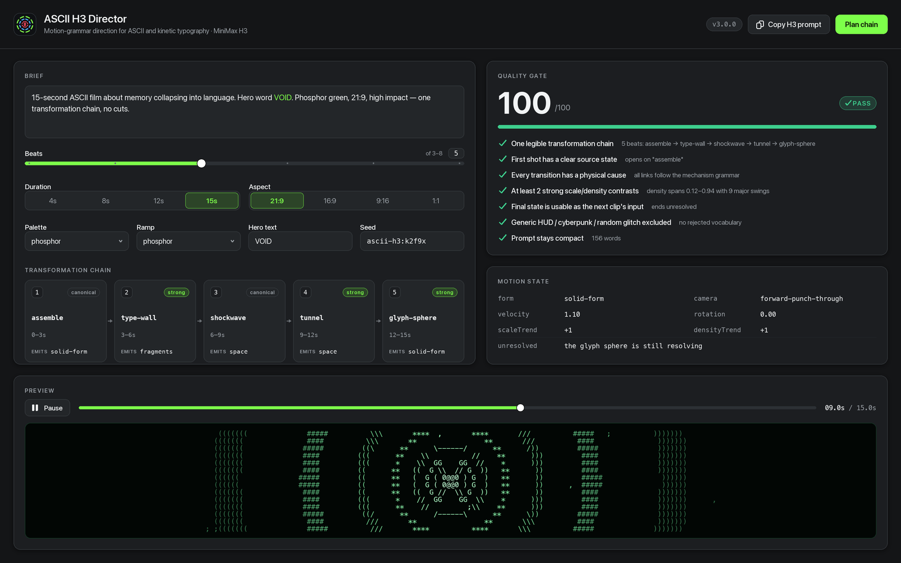
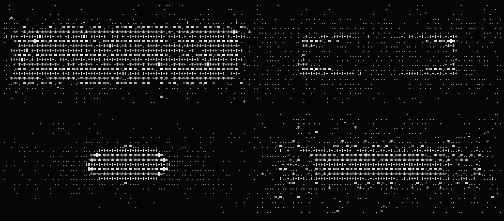
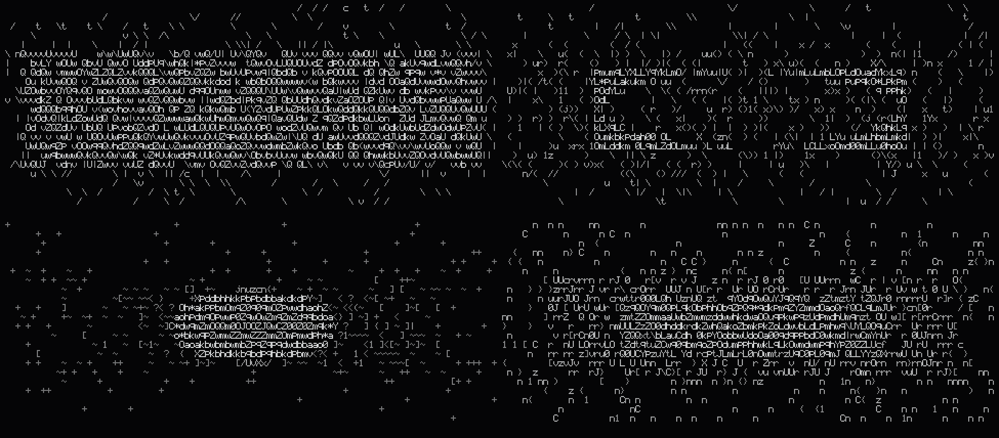
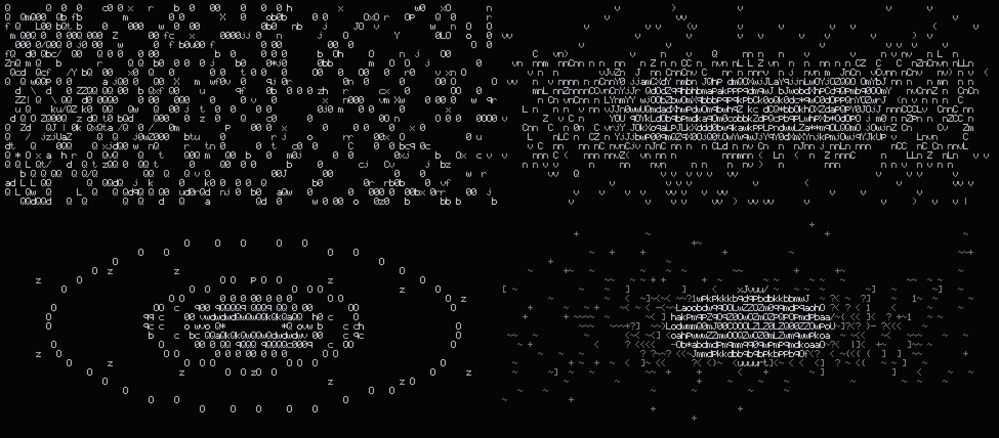

# ASCII H3 Director

[](LICENSE)
[](https://nodejs.org)
[](#requirements)
[](https://github.com/deepseek-ai/deepseek-harness)
[](#install)
[](https://github.com/MiniMax-AI/MiniMax-H3)

[中文](README.zh-CN.md) · **English** · [한국어](README.ko.md) · [日本語](README.ja.md) · [Français](README.fr.md)

---

> Force one idea into a chain of characters that will not stop changing shape.

## What it is

ASCII H3 Director is a directing tool for MiniMax H3. It compiles a free-form brief into a **transformation chain**, a prompt written for time rather than prose, and a quality gate that stands between you and the pay button. It also ships a deterministic ASCII render engine: a 5×9 hand-authored bitmap font that turns the same FilmSpec into byte-reproducible terminal frames, SVGs, PNGs, and contact sheets. It is both a **DeepSeek Harness (DSH) plugin** and a portable **Agent Skill**.

## What's new in v3 (against v1)

v1 was a Markdown skill plus bash scripts. `generate_h3.sh` forwarded to `mmx video generate`, `continue_from_last_frame.sh` used ffmpeg to pull the last frame of the previous clip, `make_contact_sheet.sh` tiled frames through an ffmpeg filter, and every directorial rule lived as prose inside `SKILL.md`. It worked — but the judgement was on the model's honour, and you had to pay before you could see a single frame.

| Capability | v1 | v3 |
| --- | --- | --- |
| Shape | Markdown + bash wrappers | 8 zero-dependency ES modules + DSH plugin + Agent Skill |
| Seeing the frame | Generate first, then extract with ffmpeg | Deterministic preview engine — no API key required |
| Type | None (terminal font) | Hand-authored 5×9 bitmap covering all 95 printable ASCII glyphs |
| Reproducibility | Unspecified | Seeded; two renders of one FilmSpec matched SHA-256 (measured) |
| Motion logic | Prose rules | 21-mechanism grammar library + a `FORM_SUCCESSORS` legality table |
| Continuation | "preserve the previous motion" | Continuity contract: `exit_state` → `entry_state` + `checkSeam` |
| Quality | 6 self-directed questions | 7 automated checks scored /100; no PASS, no generation |
| Reference analysis | "extract the motion grammar" (manual) | `reference` subcommand: STYLE DNA and chain inferred from observations |
| Contact sheet | ffmpeg required | Built-in PNG encoder + SVG sheets, **no ffmpeg** |
| Delivery | Anything that reads SKILL.md | DSH Cordis plugin with host tools and a Director Console panel |
| Docs | English | Chinese / Japanese / English |

## Install

**Path A — DSH plugin**

```bash
# from npm
dsh plugin --profile web add @yankafei/ascii-h3-director

# or from a local path (development)
dsh plugin --profile web add /Users/coffee/Desktop/创造一切可能/ascii-h3-director
```

Once installed, the plugin registers its host tools with the session and mounts the **Director Console** panel in the Web UI.

**Path B — generic Agent Skill**

```bash
# copy by hand
mkdir -p ~/.agents/skills
cp -R skill ~/.agents/skills/ascii-h3-director

# or run the installer
skill/INSTALL.command
```

The installer copies `skill/` to `~/.agents/skills/ascii-h3-director/` and prints the self-check command. The two paths do not conflict: the plugin serves DSH, the skill serves any coding agent that reads `SKILL.md`.

## Quick start

Everything below is a real, copy-pasteable transcript. No API key, no cost.

```console
$ ascii-h3 doctor
ascii-h3-director v3.0.0

[ok] node                         v24.19.0
[ok] engine modules               8 ramps, 5 palettes
[ok] glyph atlas                  5×9 bitmap font, printable ASCII
[ok] mechanisms                   21 mechanisms in the grammar
[ok] png encoder                  built-in, no image library required
[ok] render smoke test            N cells in Mms
[ok] quality gate                 score 100/100
[ok] mmx-cli (paid generation)    not installed — optional; install with: npm i -g mmx-cli

all core checks passed

$ ascii-h3 plan "15s ASCII clip about memory collapsing into language"
TITLE      15s / ascii / memory / collapsing
SEED       ascii-h3:1wok55r
DURATION   15s @ 21:9
LOOK       brutalist-digital / brutalist / high-impact
HERO TEXT  —

TRANSFORMATION CHAIN
   1. 0–3s       Density Dissolve  [canonical]
      the form dematerialises because its glyph ramp slides toward emptiness while its silhouette holds
      exit → form=field camera=forward-punch-through v=1
   2. 3–6s       Glyph Sphere  [strong]
      thousands of characters orbit a tiny focal mark, then all orbits converge
      exit → form=solid-form camera=forward-punch-through v=1
   3. 6–9s       Typographic Wall  [strong]
      the camera punches through each wall without cutting; the wall shatters from the point of impact outward
      exit → form=fragments camera=forward-punch-through v=1
   4. 9–12s      Command Shockwave  [canonical]
      the release from compression travels outward as a single readable command, dragging microtype in its wake
      exit → form=space camera=forward-punch-through v=1
   5. 12–15s     ASCII Tunnel  [strong]
      the camera travels forward through the rings while they stretch into long perspective trails
      exit → form=space camera=forward-punch-through v=1

QUALITY GATE  PASS  (100/100)
────────────────────────────────────────────────────────────────
  ✔ One legible transformation chain
      5 beat(s): density-dissolve → glyph-sphere → type-wall → shockwave → tunnel
  ✔ First shot has a clear source state
      opens on "density-dissolve"
  ✔ Every transition has a physical cause
      all links follow the mechanism grammar
  ✔ At least 2 strong scale/density contrasts
      density spans 0.12–0.94 with 9 major swing(s)
  ✔ Final state is usable as the next clip’s input
      ends unresolved: the camera is still inside the tunnel with speed left over
  ✔ Generic HUD / cyberpunk / random glitch excluded
      no rejected vocabulary in the positive prompt
  ✔ Prompt stays compact (written for time, not prose)
      153 words

PROMPT (153 words)
────────────────────────────────────────────────────────────────
15-second ultra-wide ASCII kinetic typography sequence.

0–3s: The form dematerialises because its glyph ramp slides toward emptiness while its silhouette holds.
3–6s: Thousands of characters orbit a tiny focal mark, then all orbits converge.
6–9s: The camera punches through each wall without cutting; the wall shatters from the point of impact outward.
9–12s: The release from compression travels outward as a single readable command, dragging microtype in its wake.
12–15s: The camera travels forward through the rings while they stretch into long perspective trails. The camera is still inside the tunnel with speed left over.

STYLE: brutalist digital palette; brutalist character set; brutalist computational motion design; extreme perspective and scale contrast; monospaced glyphs as physical matter, not overlay; 21:9 frame.
RULE: no normal cuts; every transformation physically emerges from the previous form; preserve direction, velocity and scale across every transition; avoid generic HUD, cyberpunk city, random glitch, unmotivated particles, smoke wipes, photoreal humans.

$ ascii-h3 preview "a brutalist ASCII tunnel collapsing into a giant word OPEN" --cols 100 --rows 24
                                  t C                             C
   C                                                                                     C     C
  C        t t     C                 t                             CC                            C
  C C                                 C         C                t
 t      C               t            C                                  GC      t    t
         C          C00CC  C    8 C G   0CCC G   CCCC  C    C    CCG t   C  C     C 0CC0CtC    0  C
  0  C      C  Ct G   CC  C  01G08   C Ct 00000 C C0 0C  C CCCG C0C  C  CC  C   0 G C   0     C 1G
  ... (24 rows of deterministic glyphs)

$ ascii-h3 strip "brutalist ASCII tunnel into giant word OPEN" --frames 6 --out sheet.png
wrote sheet.png (6 frames, 3×2, 1840×592)
```

Drop `--cols/--rows` to compose in the terminal first, then raise them for the final image; point `--out` at a `.svg` to get a vector sheet.

**The one step that costs money** (and it is gated on the quality gate):

```bash
# 1. write the prompt
ascii-h3 prompt "15s ASCII clip about memory collapsing into language" --out prompt.txt

# 2. generate (H3 is a paid service; this is the only billable call in the repo)
mmx video generate --model MiniMax-H3 --prompt "$(cat prompt.txt)" \
  --duration 15 --ratio 21:9 --download outputs/clip01.mp4
```

With `mmx` absent, `doctor` reports it as optional rather than failing — the engine never depends on it.

## Command reference

| Command | Arguments | What it does |
| --- | --- | --- |
| `plan` | `"<brief>" [--seed S] [--beats N] [--json]` | Full direction plan: chain, per-beat motion state, quality gate |
| `chain` | `"<brief>" [--beats N] [--json]` | Just the transformation chain |
| `prompt` | `"<brief>" [--out FILE]` | Only the compact H3 prompt |
| `review` | `["<brief>"] [--out prompt.txt] [--json]` | Run the quality gate alone; `--out` audits an existing prompt |
| `reference` | `<obs.json> [--json]` | Extract STYLE DNA and a reproducible chain from reference observations |
| `continue` | `<exit-state.json> "<brief>" [--json]` | Plan a seamless sequel inheriting the previous exit state, reporting seam violations |
| `preview` | `"<brief>" [--t SEC] [--cols N] [--rows N]` | Print one ASCII frame to the terminal |
| `svg` | `"<brief>" --t SEC --out FILE.svg` | Export one vector frame |
| `png` | `"<brief>" --t SEC --out FILE.png` | Export one raster frame via the built-in encoder |
| `strip` | `"<brief>" [--frames N] [--cols N] [--rows N] --out FILE.png\|.svg` | Contact sheet of N evenly spaced frames; no ffmpeg |
| `mechanisms` | `[--json]` | Print the motion grammar, grouped by tier |
| `doctor` | — | Self-check plus a real render smoke test |
| `help` / `version` | — | Usage / version |

Common flags: `--seed --beats --duration --ratio --palette --ramp --mode --text "WORD,WORD" --avoid "a,b" --allow --block`, plus `--t --cols --rows --cellW --cellH` for rendering.

Choices: `--ramp` ∈ `classic brutalist minimal operators binary data phosphor typographic`; `--palette` ∈ `brutalist-digital minimal-signal phosphor paper-terminal monolith`; `--mode` ∈ `high-impact minimal-data`; `--ratio` ∈ `21:9 16:9 9:16 4:3 1:1 adaptive`.

## The motion grammar

A clip is not a style; it is a **transformation chain**. Characters change function over time: text becomes pattern, pattern becomes particles, particles become geometry, geometry becomes space, space becomes typography again. The library holds 21 mechanisms across four tiers.

| Tier | id | Name | Emits |
| --- | --- | --- | --- |
| canonical | `assemble` | Assemble from Sparse Field | `solid-form` |
| canonical | `density-dissolve` | Density Dissolve | `field` |
| canonical | `structural-decay` | Structural Decay | `fragments` |
| canonical | `letter-fragmentation` | Diegetic Letter-Topology Fragmentation | `fragments` |
| canonical | `implosion` | Implosion | `void` |
| canonical | `shockwave` | Command Shockwave | `space` |
| canonical | `cursor-vortex` | Cursor Vortex | `void` |
| strong | `boot-signal` | Boot Signal | `letterform` |
| strong | `contour-migration` | Contour Migration | `solid-form` |
| strong | `tunnel` | ASCII Tunnel | `space` |
| strong | `type-wall` | Typographic Wall | `fragments` |
| strong | `glyph-sphere` | Glyph Sphere | `solid-form` |
| strong | `giant-word` | Giant Cropped Typography | `letterform` |
| strong | `spatial-fold` | Spatial Fold | `space` |
| support | `field` | Character Field | `field` |
| support | `mask` | Text Mask | `letterform` |
| reject | `reject-hud` | Decorative HUD | `cliche` |
| reject | `reject-city` | Generic Cyberpunk City | `cliche` |
| reject | `reject-glitch` | Meaningless Glitch | `cliche` |
| reject | `reject-particles` | Unmotivated Particles | `cliche` |
| reject | `reject-smoke` | Smoke / Liquid Wipe | `cliche` |

The `reject` tier stays in the grammar on purpose: the reviewer has to be able to **name** a failure, not just call it weak. Legal successors come from `FORM_SUCCESSORS` — for example `solid-form → density-dissolve | contour-migration | implosion | type-wall`, and `space → type-wall | tunnel | spatial-fold | glyph-sphere | structural-decay`.

## The continuity contract

A sequel is not a new scene. The predecessor's `exit_state` **becomes** the successor's `entry_state`: camera vector, apparent velocity, rotation, scale trend, density trend, palette and charset all inherit, and only the unresolved action is handed over rather than re-declared.

A violating seam (camera reset, palette change, velocity dropped to zero — `checkSeam` reports each one):

```diff
  // exit_state.json (previous clip's exit)
  { "form": "solid-form", "camera": "forward-punch-through",
-   "velocity": 1.1, "palette": "brutalist-digital", "ramp": "brutalist",
-   "unresolved": "the glyph sphere is still resolving when the clip ends" }
  // entry_state (the sequel opens) — wrong
+ { "form": "void", "camera": "orbital-lock",
+   "velocity": 0, "palette": "phosphor", "ramp": "minimal",
+   "unresolved": "the glyph sphere is still resolving when the clip ends" }
```

Corrected (what `inherit()` produces; `checkSeam` returns an empty array):

```json
{
  "form": "solid-form",
  "camera": "forward-punch-through",
  "velocity": 1.21,
  "rotation": 0,
  "scaleTrend": -1,
  "densityTrend": 1,
  "unresolved": "",
  "palette": "brutalist-digital",
  "ramp": "brutalist"
}
```

`checkSeam` tests for: a camera vector that resets, apparent velocity dropped to zero, velocity reversing direction across the seam, a palette change, a change of dominant charset, and an unresolved action repeated instead of closed. `ascii-h3 continue` prints every violation under `SEAM: BROKEN`; `SEAM: holds` means the seam is intact.

## Quality gate

Before you pay, all 7 checks must answer yes. The score is passing checks / 7 × 100, and only a clean sweep returns `PASS`.

| id | Check | What a failure means |
| --- | --- | --- |
| `single-chain` | One legible transformation chain (≥3 beats) | The concept is diffuse; collapse it into one chain |
| `source-state` | The first shot has a clear source state | No origin, so the audience has nothing to enter from |
| `physical-cause` | Every transition has a physical cause | A link has no legal successor in the grammar |
| `contrast` | At least 2 strong scale/density contrasts | The frame is flat; widen the compression and release swing |
| `exit-state` | The final state is usable as the next clip's input | The clip resolves completely and cannot continue |
| `no-cliche` | No generic HUD / cyberpunk / random glitch | Rejected vocabulary leaked into the positive prompt |
| `compact` | Prompt stays compact (≤320 words) | It is written as prose instead of for time |

## The interface

The Director Console puts all of this inside the DSH Web UI: the brief and flags on the left, the transformation chain with per-beat motion state in the middle, the gate score and a live preview on the right.



Contact sheets and preview frames from the deterministic engine:







## Repository layout

```
ascii-h3-director/
├── src/
│   ├── cli.js             # command surface: 13 subcommands, arg parsing, doctor
│   ├── core.js            # seeded RNG, easing, value noise, 8 ramps, 5 palettes
│   ├── glyph-atlas.js     # hand-authored 5×9 bitmap font (ASCII 32–126, 95 glyphs)
│   ├── renderer.js        # Grid / Camera / primitives / planFilm / renderFilmFrame
│   ├── motion-grammar.js  # 21 mechanisms, FORM_SUCCESSORS, inherit / checkSeam
│   ├── director.js        # brief parsing, prompt composition, gate, reference, sequel
│   ├── raster.js          # Grid → text / SVG / RGB
│   └── png.js             # built-in PNG encoder (zlib only, no image library)
├── skill/                 # portable Agent Skill (SKILL.md + references + scripts)
├── docs/                  # trilingual documentation
├── assets/                # README images and contact sheets
└── test/                  # determinism regression tests
```

## Requirements

- **Node 18+** (`doctor` checks the major version explicitly)
- The engine has **zero runtime dependencies**: it runs without a `node_modules`, and PNGs are written by the built-in encoder
- **ffmpeg is optional**: `strip`, `preview`, `svg` and `png` never need it
- **`mmx-cli` is optional**: `npm i -g mmx-cli`, used only for paid generation

## Credits & prior art

- [MiniMax-AI/MiniMax-H3](https://github.com/MiniMax-AI/MiniMax-H3) — the H3 model and the official prompt-writing skill
- [MiniMax-AI/cli](https://github.com/MiniMax-AI/cli) — the `mmx` CLI for paid generation and downloads
- [mexicat/pdoom-video](https://github.com/mexicat/pdoom-video) — style bible, timeline thinking, contact-sheet review
- [mrdoob/three.js](https://github.com/mrdoob/three.js) — `AsciiEffect`, the early reference for ASCII rendering
- [remotion-dev/remotion](https://github.com/remotion-dev/remotion) — constants-first timing and programmable render flow
- [motion-canvas/motion-canvas](https://github.com/motion-canvas/motion-canvas) — optional code-rendered vector/text fallback
- [deepseek-ai/deepseek-harness](https://github.com/deepseek-ai/deepseek-harness) — the host for the plugin, tools and panel

## License

MIT. Contributions: keep the three languages in sync and leave `ascii-h3 doctor` green.

<p align="center" data-ecosystem-nav="1"><sub><a href="https://github.com/YanKaFei/Costume-Director-Vault-Starter">Costume</a> · <a href="https://github.com/YanKaFei/art-aesthetic-vault">Art</a> · <a href="https://github.com/YanKaFei/ascii-cinema-engine">ASCII Cinema</a> · <a href="https://github.com/YanKaFei/ascii-h3-director">ASCII H3</a> · <a href="https://github.com/YanKaFei/2d-limited-mv-studio">2D MV</a> · <a href="https://github.com/YanKaFei/virtual-heroine-atlas">Virtual Heroine</a></sub></p>


## DSH ecosystem

- [Costume](https://github.com/YanKaFei/Costume-Director-Vault-Starter) — 服装视觉知识库
- [Art](https://github.com/YanKaFei/art-aesthetic-vault) — 艺术风格库
- [ASCII Cinema](https://github.com/YanKaFei/ascii-cinema-engine) — ASCII 电影引擎
- [ASCII H3](https://github.com/YanKaFei/ascii-h3-director) — ASCII / 动态字体导演
- [2D MV](https://github.com/YanKaFei/2d-limited-mv-studio) — 2D 动画 MV 工坊
- [Virtual Heroine](https://github.com/YanKaFei/virtual-heroine-atlas) — 虚拟女主角图鉴
