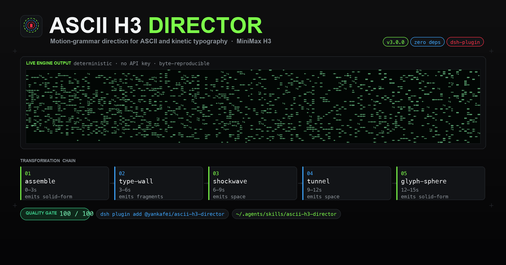
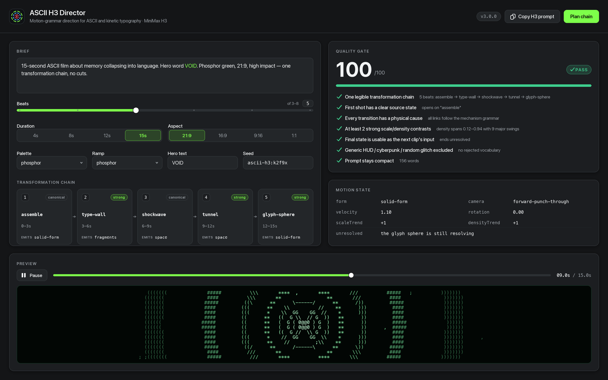
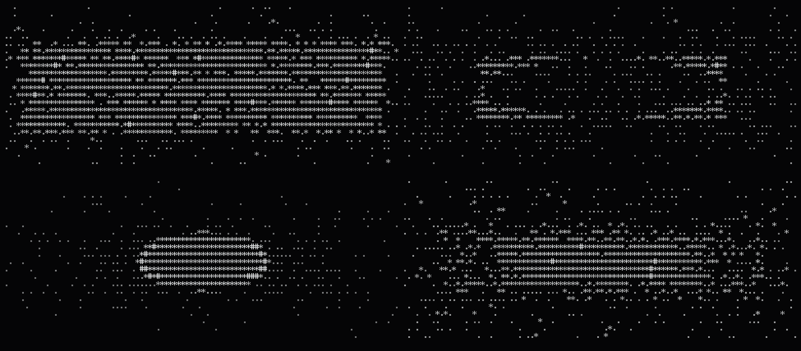
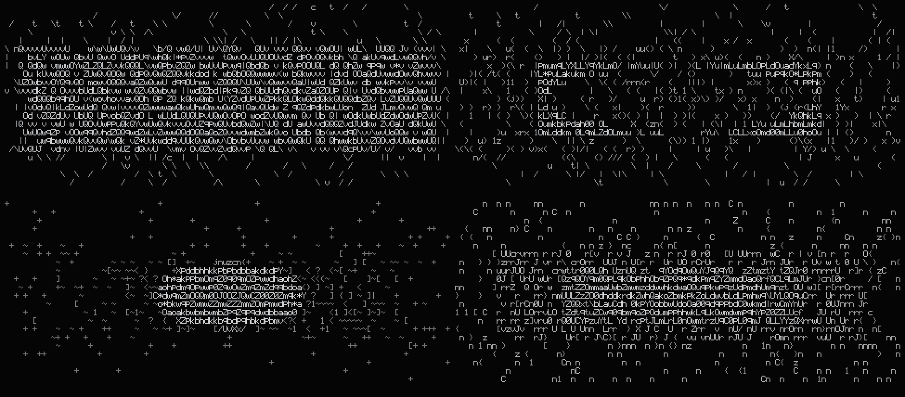
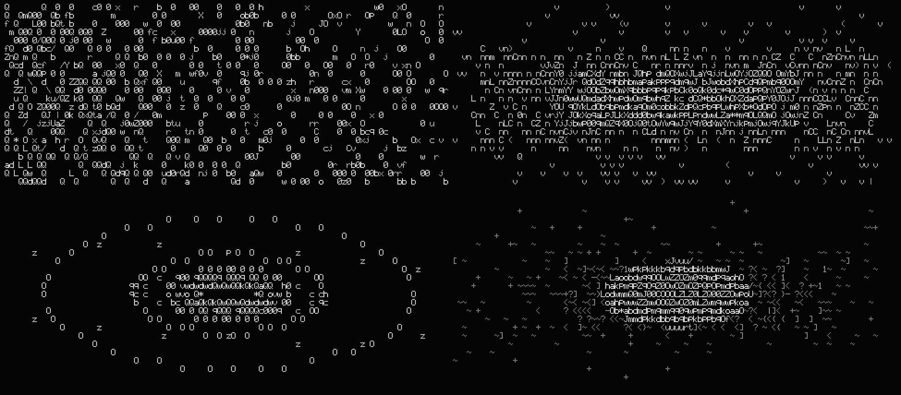

# ASCII H3 Director

[](LICENSE)
[](https://nodejs.org)
[](#requirements)
[](https://github.com/deepseek-ai/deepseek-harness)
[](#install)
[](https://github.com/MiniMax-AI/MiniMax-H3)

[**中文**](README.zh-CN.md) · [English](README.md) · [한국어](README.ko.md) · [日本語](README.ja.md) · [Français](README.fr.md)

---

> 把一个念头，逼成一条会变形的字符链。



## 这是什么

ASCII H3 Director 是一个为 MiniMax H3 服务的导演工具：它把一句自由描述，编译成一条**变形链**（transformation chain）、一份写给时间而非散文的紧凑提示词，以及一套可在付款前拦下你的质量闸门。同时它自带一个确定性的 ASCII 渲染引擎——不联网、不调用任何图像库，用 5×9 手工点阵字库把同一份 FilmSpec 渲染成逐字节可复现的终端帧、SVG、PNG 和接触印样。它既是 **DeepSeek Harness（DSH）插件**，也是一个可移植的 **Agent Skill**。

## v3 新增了什么（对比 v1）

v1 是一份 Markdown 技能包加几个 bash 脚本：`generate_h3.sh` 转发给 `mmx video generate`，`continue_from_last_frame.sh` 用 ffmpeg 抽出上一段视频的最后一帧，`make_contact_sheet.sh` 用 ffmpeg 的 `tile` 滤镜拼印样，导演逻辑全部写在 `SKILL.md` 的散文规则里。它能用，但所有判断都靠模型自觉，所有画面都要先付钱才能看见。

| 能力 | v1 | v3 |
| --- | --- | --- |
| 形态 | Markdown + bash 包装脚本 | 8 个零依赖 ES 模块 + DSH 插件 + Agent Skill |
| 看到画面 | 必须先花钱生成，再用 ffmpeg 抽帧 | 确定性预览引擎，零 API key 即可看片 |
| 字库 | 无（依赖终端字体） | 手写 5×9 点阵，覆盖可打印 ASCII 全部 95 个字形 |
| 可复现性 | 无保证 | 种子驱动，同一 FilmSpec 两次渲染 SHA-256 完全一致（已实测） |
| 运动逻辑 | 散文规则，靠自觉 | 21 条机制的语法库 + `FORM_SUCCESSORS` 合法后继表 |
| 衔接 | "保留上一帧的运动" | 连续性契约：`exit_state` → `entry_state` 继承 + `checkSeam` 校验 |
| 质量把关 | 6 条自问自答 | 7 项检查自动打分 `/100`，不过闸门不生成 |
| 参考片分析 | "提取运动语法"（人工） | `reference` 子命令：从观测 JSON 反推 STYLE DNA 与链条 |
| 印样 | ffmpeg 必需 | 内置 PNG 编码器 + SVG 接触印样，**不需要 ffmpeg** |
| 载体 | 只要支持 SKILL.md | DSH Cordis 插件（宿主工具 + Director Console 面板） |
| 文档 | 英文 | 中 / 日 / 英 三语 |

## 安装

**路径 A — DSH 插件**

```bash
# 从 npm
dsh plugin --profile web add @yankafei/ascii-h3-director

# 或从本地路径（开发时）
dsh plugin --profile web add /Users/coffee/Desktop/创造一切可能/ascii-h3-director
```

装好后插件会向会话注册宿主工具，并在 Web UI 里挂上 **Director Console** 面板。

**路径 B — 通用 Agent Skill**

```bash
# 方法一：手动拷贝
mkdir -p ~/.agents/skills
cp -R skill ~/.agents/skills/ascii-h3-director

# 方法二：跑安装脚本
skill/INSTALL.command
```

脚本会把 `skill/` 复制到 `~/.agents/skills/ascii-h3-director/` 并打印自检命令。两条路径互不冲突：插件给 DSH，Skill 给任何读 `SKILL.md` 的编码代理。

## 快速上手

以下全部是真实可复制的终端记录；这个阶段不需要 API key，也不花一分钱。

```console
$ ascii-h3 doctor
ascii-h3-director v3.0.0

[ok] node                         v24.19.0
[ok] engine modules               8 ramps, 5 palettes
[ok] glyph atlas                  5×9 bitmap font, printable ASCII
[ok] mechanisms                   21 mechanisms in the grammar
[ok] png encoder                  built-in, no image library required
[ok] render smoke test            N cells in Mms
[ok] quality gate                 score 100/100
[ok] mmx-cli (paid generation)    not installed — optional; install with: npm i -g mmx-cli

all core checks passed

$ ascii-h3 plan "15s ASCII clip about memory collapsing into language"
TITLE      15s / ascii / memory / collapsing
SEED       ascii-h3:1wok55r
DURATION   15s @ 21:9
LOOK       brutalist-digital / brutalist / high-impact
HERO TEXT  —

TRANSFORMATION CHAIN
   1. 0–3s       Density Dissolve  [canonical]
      the form dematerialises because its glyph ramp slides toward emptiness while its silhouette holds
      exit → form=field camera=forward-punch-through v=1
   2. 3–6s       Glyph Sphere  [strong]
      thousands of characters orbit a tiny focal mark, then all orbits converge
      exit → form=solid-form camera=forward-punch-through v=1
   3. 6–9s       Typographic Wall  [strong]
      the camera punches through each wall without cutting; the wall shatters from the point of impact outward
      exit → form=fragments camera=forward-punch-through v=1
   4. 9–12s      Command Shockwave  [canonical]
      the release from compression travels outward as a single readable command, dragging microtype in its wake
      exit → form=space camera=forward-punch-through v=1
   5. 12–15s     ASCII Tunnel  [strong]
      the camera travels forward through the rings while they stretch into long perspective trails
      exit → form=space camera=forward-punch-through v=1

QUALITY GATE  PASS  (100/100)
────────────────────────────────────────────────────────────────
  ✔ One legible transformation chain
      5 beat(s): density-dissolve → glyph-sphere → type-wall → shockwave → tunnel
  ✔ First shot has a clear source state
      opens on "density-dissolve"
  ✔ Every transition has a physical cause
      all links follow the mechanism grammar
  ✔ At least 2 strong scale/density contrasts
      density spans 0.12–0.94 with 9 major swing(s)
  ✔ Final state is usable as the next clip’s input
      ends unresolved: the camera is still inside the tunnel with speed left over
  ✔ Generic HUD / cyberpunk / random glitch excluded
      no rejected vocabulary in the positive prompt
  ✔ Prompt stays compact (written for time, not prose)
      153 words

PROMPT (153 words)
────────────────────────────────────────────────────────────────
15-second ultra-wide ASCII kinetic typography sequence.

0–3s: The form dematerialises because its glyph ramp slides toward emptiness while its silhouette holds.
3–6s: Thousands of characters orbit a tiny focal mark, then all orbits converge.
6–9s: The camera punches through each wall without cutting; the wall shatters from the point of impact outward.
9–12s: The release from compression travels outward as a single readable command, dragging microtype in its wake.
12–15s: The camera travels forward through the rings while they stretch into long perspective trails. The camera is still inside the tunnel with speed left over.

STYLE: brutalist digital palette; brutalist character set; brutalist computational motion design; extreme perspective and scale contrast; monospaced glyphs as physical matter, not overlay; 21:9 frame.
RULE: no normal cuts; every transformation physically emerges from the previous form; preserve direction, velocity and scale across every transition; avoid generic HUD, cyberpunk city, random glitch, unmotivated particles, smoke wipes, photoreal humans.

$ ascii-h3 preview "a brutalist ASCII tunnel collapsing into a giant word OPEN" --cols 100 --rows 24
                                  t C                             C
   C                                                                                     C     C
  C        t t     C                 t                             CC                            C
  C C                                 C         C                t
 t      C               t            C                                  GC      t    t
         C          C00CC  C    8 C G   0CCC G   CCCC  C    C    CCG t   C  C     C 0CC0CtC    0  C
  0  C      C  Ct G   CC  C  01G08   C Ct 00000 C C0 0C  C CCCG C0C  C  CC  C   0 G C   0     C 1G
  ... (24 行确定性字形)

$ ascii-h3 strip "brutalist ASCII tunnel into giant word OPEN" --frames 6 --out sheet.png
wrote sheet.png (6 frames, 3×2, 1840×592)
```

把 `--cols/--rows` 调小可以先在终端里构图，再放大出图；`--out` 换成 `.svg` 就得到矢量印样。

**唯一花钱的一步**（必须闸门先 PASS）：

```bash
# 1. 写出提示词
ascii-h3 prompt "15s ASCII clip about memory collapsing into language" --out prompt.txt

# 2. 生成（H3 是付费服务；仓库里唯一会产生费用的调用）
mmx video generate --model MiniMax-H3 --prompt "$(cat prompt.txt)" \
  --duration 15 --ratio 21:9 --download outputs/clip01.mp4
```

`mmx` 未安装时，`doctor` 会把它标为可选而不是失败——引擎本身从不依赖它。

## 命令参考

| 命令 | 参数 | 作用 |
| --- | --- | --- |
| `plan` | `"<brief>" [--seed S] [--beats N] [--json]` | 完整导演方案：变形链、每拍运动状态、质量闸门 |
| `chain` | `"<brief>" [--beats N] [--json]` | 只输出变形链 |
| `prompt` | `"<brief>" [--out FILE]` | 只输出紧凑的 H3 提示词 |
| `review` | `["<brief>"] [--out prompt.txt] [--json]` | 单独跑质量闸门；`--out` 可让闸门审查已有提示词 |
| `reference` | `<obs.json> [--json]` | 从参考片观测 JSON 提取 STYLE DNA 与可复现的运动链 |
| `continue` | `<exit-state.json> "<brief>" [--json]` | 规划无缝续集：继承上一段出口状态，并报告接缝违规 |
| `preview` | `"<brief>" [--t SEC] [--cols N] [--rows N]` | 在终端打印单帧 ASCII |
| `svg` | `"<brief>" --t SEC --out FILE.svg` | 导出矢量帧 |
| `png` | `"<brief>" --t SEC --out FILE.png` | 导出位图帧（内置编码器） |
| `strip` | `"<brief>" [--frames N] [--cols N] [--rows N] --out FILE.png\|.svg` | 接触印样：N 张等距帧拼成一张图，不需要 ffmpeg |
| `mechanisms` | `[--json]` | 打印运动语法库（按层级分组） |
| `doctor` | — | 自检并跑一次渲染冒烟测试 |
| `help` / `version` | — | 用法 / 版本 |

通用标志：`--seed --beats --duration --ratio --palette --ramp --mode --text "WORD,WORD" --avoid "a,b" --allow --block`，另加渲染用的 `--t --cols --rows --cellW --cellH`。

可选值：`--ramp` ∈ `classic brutalist minimal operators binary data phosphor typographic`；`--palette` ∈ `brutalist-digital minimal-signal phosphor paper-terminal monolith`；`--mode` ∈ `high-impact minimal-data`；`--ratio` ∈ `21:9 16:9 9:16 4:3 1:1 adaptive`。

## 运动语法

一条片子不是一种"风格"，而是一条**变形链**：字随时间改变职能——文字变成图案，图案变成粒子，粒子变成几何，几何变成空间，空间再变回文字。语法库共 21 条机制，分四层。

| 层级 | id | 名称 | 留下什么（emits） |
| --- | --- | --- | --- |
| canonical | `assemble` | Assemble from Sparse Field | `solid-form` |
| canonical | `density-dissolve` | Density Dissolve | `field` |
| canonical | `structural-decay` | Structural Decay | `fragments` |
| canonical | `letter-fragmentation` | Diegetic Letter-Topology Fragmentation | `fragments` |
| canonical | `implosion` | Implosion | `void` |
| canonical | `shockwave` | Command Shockwave | `space` |
| canonical | `cursor-vortex` | Cursor Vortex | `void` |
| strong | `boot-signal` | Boot Signal | `letterform` |
| strong | `contour-migration` | Contour Migration | `solid-form` |
| strong | `tunnel` | ASCII Tunnel | `space` |
| strong | `type-wall` | Typographic Wall | `fragments` |
| strong | `glyph-sphere` | Glyph Sphere | `solid-form` |
| strong | `giant-word` | Giant Cropped Typography | `letterform` |
| strong | `spatial-fold` | Spatial Fold | `space` |
| support | `field` | Character Field | `field` |
| support | `mask` | Text Mask | `letterform` |
| reject | `reject-hud` | Decorative HUD | `cliche` |
| reject | `reject-city` | Generic Cyberpunk City | `cliche` |
| reject | `reject-glitch` | Meaningless Glitch | `cliche` |
| reject | `reject-particles` | Unmotivated Particles | `cliche` |
| reject | `reject-smoke` | Smoke / Liquid Wipe | `cliche` |

`reject` 层故意留在语法库里——审查器需要能**说出**失败的名字，而不是只说"不好"。合法后继由 `FORM_SUCCESSORS` 决定，例如 `solid-form → density-dissolve | contour-migration | implosion | type-wall`，`space → type-wall | tunnel | spatial-fold | glyph-sphere | structural-decay`。

## 连续性契约

续集不是新场景。上一段的 `exit_state` 会**成为**下一段的 `entry_state`——摄影机向量、表观速度、旋转、缩放趋势、密度趋势、调色板、字符集全部继承，只有未完成的动作被移交而不是重新声明。

非法示例（摄影机复位 + 调色板跳变 + 速度归零，`checkSeam` 会逐条报出）：

```diff
  // exit_state.json（上一段出口）
  { "form": "solid-form", "camera": "forward-punch-through",
-   "velocity": 1.1, "palette": "brutalist-digital", "ramp": "brutalist",
-   "unresolved": "the glyph sphere is still resolving when the clip ends" }
  // entry_state（续集开头）——错误
+ { "form": "void", "camera": "orbital-lock",
+   "velocity": 0, "palette": "phosphor", "ramp": "minimal",
+   "unresolved": "the glyph sphere is still resolving when the clip ends" }
```

修正后（`inherit()` 的产物，`checkSeam` 返回空数组）：

```json
{
  "form": "solid-form",
  "camera": "forward-punch-through",
  "velocity": 1.21,
  "rotation": 0,
  "scaleTrend": -1,
  "densityTrend": 1,
  "unresolved": "",
  "palette": "brutalist-digital",
  "ramp": "brutalist"
}
```

`checkSeam` 会检查：摄影机向量是否复位；表观速度是否被归零；速度方向是否在接缝处反转；调色板是否改变；主导字符集是否改变；未完成的动作是否被重复而不是收尾。`ascii-h3 continue` 会把违规逐条打印在 `SEAM: BROKEN` 之下；`SEAM: holds` 表示接缝成立。

## 质量闸门

付款前，7 项检查每一项都要能回答"是"。得分 = 通过数 / 7 × 100，全通过才 `PASS`。

| id | 检查 | 失败意味着 |
| --- | --- | --- |
| `single-chain` | 存在一条可读的变形链（≥3 拍） | 概念太散，先收敛成一条链 |
| `source-state` | 首镜有明确的起始状态 | 没有起点，观众不知道从哪开始 |
| `physical-cause` | 每个转场都有物理成因 | 出现了语法上没有合法后继的跳变 |
| `contrast` | 至少 2 次强烈的尺度/密度对比 | 画面平；加大压缩与释放的摆幅 |
| `exit-state` | 末态可作为下一段的输入 | 片子完全收尾，无法续接 |
| `no-cliche` | 正提示词里没有 HUD / 赛博城市 / 随机故障 | 陈词滥调混进了正向描述 |
| `compact` | 提示词保持紧凑（≤320 词） | 写给时间，而不是写给散文 |

## 界面

Director Console 把上面这一切放进 DSH Web UI：左栏是 brief 与标志，中栏是失真链条和逐拍状态，右栏是闸门分数与预览。



确定性引擎导出的接触印样与预览帧：







## 仓库结构

```
ascii-h3-director/
├── src/
│   ├── cli.js             # 命令面：13 个子命令、参数解析、doctor
│   ├── core.js            # 种子 RNG、缓动、值噪声、8 条 ramp、5 套 palette
│   ├── glyph-atlas.js     # 手写 5×9 点阵字库（ASCII 32–126，95 字形）
│   ├── renderer.js        # Grid / Camera / 图元 / planFilm / renderFilmFrame
│   ├── motion-grammar.js  # 21 条机制、FORM_SUCCESSORS、inherit / checkSeam
│   ├── director.js        # brief 解析、提示词合成、质量闸门、参考分析、续集
│   ├── raster.js          # Grid → 文本 / SVG / RGB
│   └── png.js             # 内置 PNG 编码器（zlib，无外部依赖）
├── skill/                 # 可移植 Agent Skill（SKILL.md + references + scripts）
├── docs/                  # 三语文档
├── assets/                # README 图像与印样
└── test/                  # 确定性回归测试
```

## 环境要求

- **Node 18+**（`doctor` 会显式检查主版本号）
- 引擎**零运行时依赖**：没有 `node_modules` 也能跑，PNG 由内置编码器写出
- **ffmpeg 可选**：`strip` / `preview` / `svg` / `png` 全部不需要它
- **`mmx-cli` 可选**：`npm i -g mmx-cli`，只用于付费生成

## 致谢与既有工作

- [MiniMax-AI/MiniMax-H3](https://github.com/MiniMax-AI/MiniMax-H3) — H3 模型与官方 prompt-writing 技能
- [MiniMax-AI/cli](https://github.com/MiniMax-AI/cli) — `mmx` CLI，付费生成与下载
- [mexicat/pdoom-video](https://github.com/mexicat/pdoom-video) — style bible、时间轴思维、印样式审查
- [mrdoob/three.js](https://github.com/mrdoob/three.js) — `AsciiEffect`，早期 ASCII 渲染的参考
- [remotion-dev/remotion](https://github.com/remotion-dev/remotion) — 常量优先的时序与可编程渲染流程
- [motion-canvas/motion-canvas](https://github.com/motion-canvas/motion-canvas) — 代码驱动矢量/文字动画的备选回退
- [deepseek-ai/deepseek-harness](https://github.com/deepseek-ai/deepseek-harness) — 插件、工具与面板的宿主

## 许可证

MIT。贡献请保持三语 README 同步，并让 `ascii-h3 doctor` 通过。

---
